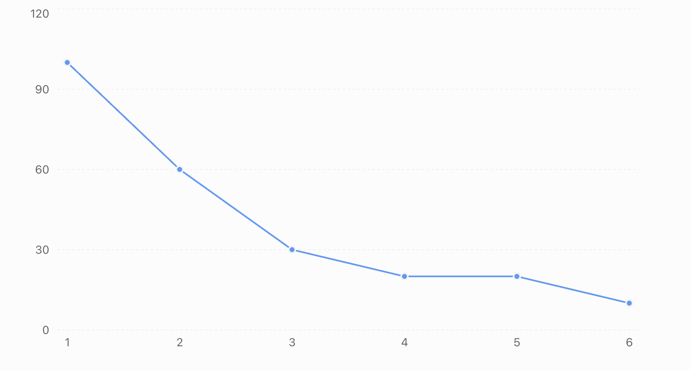

<b>Q. Why is Supervised Learning not suitable for a customer segmentation problem using K-Means?</b>

**A.** Because the dataset does not contain labeled target values.  

**B.** Because the dataset has too many features.

**C.** Because K-Means requires labeled training data.

**D.** Because supervised learning cannot handle numerical data. 

<b>Answer</b>

**A** Because the dataset does not contain labeled target values.

---  

<b>Q. Why does the centroid move to the mean during the update step instead of the median?</b>

**A.** Because the mean minimizes the total squared distance (WCSS).

**B.** Because the median is computationally expensive.

**C.** Because the mean is always one of the data points.

**D.** Because K-Means requires an odd number of points.

<b>Answer</b>

**Correct answer: A**

A. Because the mean minimizes the total squared distance (WCSS).

### Why?

K-Means uses the following objective:

`WCSS = Sum of squared distances between data points and their assigned centroid.`

During the update step, K-Means recalculates the centroid to minimize this WCSS.

Mathematically:

- Mean minimizes the sum of squared deviations.
- Median minimizes the sum of absolute deviations.

### Simple example

Suppose a cluster contains these points:

`2, 4, 6, 8, 10`

Mean:

`(2 + 4 + 6 + 8 + 10) / 5 = 6`

Median:

`6`

Here both happen to be equal. But consider:

`2, 4, 6, 8, 30`

Mean = 10

Median = 6

For standard K-Means, we use the mean because its objective is to minimize squared Euclidean distances.

Remember this distinction:

| Algorithm | Center calculation | Objective                 |
| --------- | ------------------ | ------------------------- |
| K-Means   | Mean               | Sum of squared distances  |
| K-Medians | Median             | Sum of absolute distances |

Interview takeaway: K-Means uses mean, not median, because the mean is the optimal center for minimizing the sum of squared Euclidean distances.

---  

<b>Q. What happens to WCSS as K increases (while keeping the dataset fixed)?</b>

**A.** Always increases.

**B.** Always decreases (or stays the same).

**C** Increases then decreases.

**D.** Unpredictable.

<b>Answer</b>

  
**Correct answer: B**

B. Always decreases (or stays the same).

### Why?

WCSS measures the sum of squared distances between data points and their assigned cluster centroids.

When we increase K, we increase the number of clusters.

This gives K-Means more centroids, allowing data points to be assigned to potentially closer centroids.

Therefore, WCSS can decrease or remain unchanged, but it cannot increase when we consider the optimal clustering solution.

### Example

| K (Clusters) | WCSS |
| ------------ | ---- |
| 1            | 100  |
| 2            | 60   |
| 3            | 30   |
| 4            | 20   |
| 5            | 20   |
| 6            | 10   |

Notice:

- K = 1 → 2: WCSS decreases.
- K = 2 → 3: WCSS decreases.
- K = 4 → 5: WCSS remains the same.
- K = 5 → 6: WCSS decreases.

### Why does this happen mathematically?

Suppose we have K = 2 clusters.

Now increase K to 3.

We can split an existing cluster into two smaller clusters. This gives the algorithm an opportunity to reduce the squared distances from points to their respective centroids.

It cannot make the optimal WCSS worse because the previous clustering is still a possible solution (the additional cluster can effectively remain unused).

Important distinction: This guarantee applies to the optimal WCSS for each K. In practical K-Means runs, random initialization and convergence to local minima can sometimes produce a higher observed WCSS for a larger K.

### Interview takeaway

As K increases, WCSS is monotonically non-increasing.

This is exactly why we cannot simply choose the largest K: WCSS keeps decreasing, potentially reaching zero when every data point has its own cluster. We use the Elbow Method to identify diminishing returns.

  

---  

<b>Q. If the WCSS keeps decreasing significantly after adding more clusters beyond the elbow point, which of the following is most likely happening?</b>
  

1. The model is learning better.  

2. Overfitting is occurring.  

3. The dataset is getting larger.  

4. TSS is reducing.

<b>Answer</b>
  

The correct answer is Option 2: Overfitting is occurring. ✅

Let's understand why.

## 1. What is WCSS?

WCSS (Within-Cluster Sum of Squares) measures the sum of squared distances between every data point and the centroid of its assigned cluster.

### Mathematical formula

$$\boxed{ WCSS = \sum\_{j=1}^{K} \sum\_{x_i \in C_j} \\|x_i-\mu_j\\|^2 }$$

### Understanding the symbols

- $K$ = Total number of clusters.
- $C_j$ = The $j^{th}$ cluster.
- $x_i$ = An individual data point.
- $\mu_j$ = Centroid of the $j^{th}$ cluster.
- $\\|x_i-\mu_j\\|^2$ = Squared Euclidean distance between the data point and its cluster centroid.

### Let's understand the formula

There are two summations:

Inner summation:

\\[ \sum\_{x_i \in C_j}\\|x_i-\mu_j\\|^2 \\]

Calculates the squared distances of all data points belonging to one cluster from that cluster's centroid.

Outer summation:

\\[ \sum\_{j=1}^{K} \\]

Adds the individual cluster sums to calculate the total WCSS.

### 🎯 Intuition

Imagine we have 3 clusters:

\\[ WCSS = WCSS_1 + WCSS_2 + WCSS_3 \\]

Each cluster contributes the sum of squared distances of its points from its centroid.

Lower WCSS means data points are closer to their respective centroids.

I'll use properly rendered LaTeX formatting in our upcoming ML explanations.

Lower WCSS means data points are closer to their cluster centroids.

## 2. Why does WCSS keep decreasing?

Consider what happens when we increase the number of clusters:

| Number of clusters (K) | WCSS |
| ---------------------- | ---- |
| 1                      | 1000 |
| 2                      | 600  |
| 3                      | 350  |
| 4                      | 200  |
| 5                      | 150  |
| 6                      | 110  |
| 7                      | 80   |

As we increase K, WCSS generally decreases.

Why?

Because more clusters allow data points to be grouped around closer centroids.

In fact, if every data point gets its own cluster:

\\[ K=N \implies WCSS=0 \\]

But this doesn't mean we have discovered meaningful clusters!

## 3. What is happening beyond the elbow point?

The Elbow Method helps us identify a reasonable number of clusters.

Before the elbow:

- Adding clusters significantly reduces WCSS.
- We are capturing meaningful structure.

After the elbow:

- Additional clusters provide diminishing returns.
- We may start creating unnecessarily small clusters.
- We risk fitting noise rather than meaningful patterns.

This is what the assignment intends by overfitting.

## 4. Why are the other options incorrect?

- The model is learning better: Lower WCSS alone doesn't prove better generalization or meaningful clustering.
- The dataset is getting larger: Increasing K doesn't increase the dataset size.
- TSS is reducing: TSS (Total Sum of Squares) measures overall data dispersion and does not normally decrease just because K increases.

Correct answer: Option 2

Important interview point:

> WCSS will never increase when we increase K in standard K-Means optimization. Therefore, we use the Elbow Method to avoid choosing unnecessarily large K values.

One nuance: continued WCSS reduction alone does not prove overfitting. The question uses that as a simplified indication of over-clustering beyond the elbow point.

