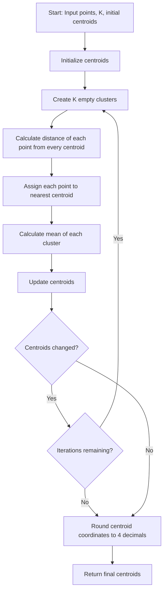
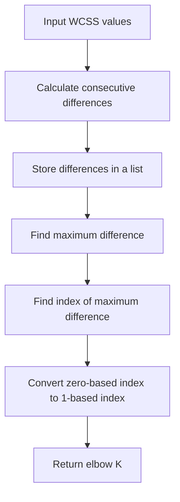

<details>
<summary><b>Q. ClusterMart's original K-Means model produced messy segments for a group of customers whose behavior formed two interleaving crescent shapes rather than round blobs. Which K-Means assumption does this most directly violate?</b></summary>

**A.** Clusters must all have the same WCSS.

**B.** Clusters are assumed to be roughly spherical (convex).

**C.** K must always be less than 4.

**D.** Distance must be measured using Manhattan distance.

<details>
<summary><b>Answer</b></summary>

**Correct Answer: Option B**

**Clusters are assumed to be roughly spherical (convex).**

### Explanation

K-Means works best when clusters are:

- Roughly spherical or convex in shape.
- Relatively compact.
- Separated based on distance from their centroids.

However, K-Means struggles when the actual clusters have complex, non-convex shapes, such as interleaving crescents or moons.

### Why?

K-Means assigns each data point to the nearest centroid using distance (typically Euclidean distance).

This creates decision boundaries between clusters that are linear (perpendicular bisectors between centroids).

Consequently, K-Means naturally produces compact, convex regions rather than complex, curved cluster boundaries.

When two clusters have interleaving crescent shapes, assigning points based on their nearest centroid cannot correctly capture their actual structure.

### Visualization

Consider two interleaving crescent-shaped clusters:


K-Means may incorrectly divide these crescent-shaped structures because it tries to group points around their respective centroids.

Algorithms such as DBSCAN and Spectral Clustering can handle non-convex cluster structures more effectively.

### Why are the other options incorrect?

- **A. Same WCSS:** K-Means does not require every cluster to have the same WCSS. WCSS measures the within-cluster sum of squared distances.
- **B. Spherical (convex):** Correct. K-Means struggles with non-convex structures such as interleaving crescents.
- **C. K less than 4:** There is no such restriction. K can be any valid positive integer up to the number of data points.
- **D. Manhattan distance:** Standard K-Means typically uses squared Euclidean distance, not Manhattan distance. However, this is not the assumption violated by the crescent-shaped data.

### Interview takeaway

Remember:

- K-Means → Works best with compact, roughly spherical (convex) clusters.
- DBSCAN → Can identify arbitrarily shaped clusters and handle noise.
- Spectral Clustering → Can identify complex, non-convex cluster structures.

**Ultimate intuition:** K-Means groups data around centroids. If the natural shape of the data cannot be represented well by centroid-based convex regions, K-Means may produce poor clustering results.

</details>
</details>

---


<details>
<summary><b>Q. Marketing complains that the same customer dataset produces different customer segments every time the model is rerun. Which of the following directly addresses this issue?</b></summary>

**A.** Switch to Hierarchical Clustering.

**B.** Use K-Means++ for smarter, well-separated initialization.

**C.** Increase the number of clusters (K).

**D.** Use a different distance metric.

<details>
<summary><b>Answer</b></summary>

**Correct Answer: Option B**

**Use K-Means++ for smarter, well-separated initialization.**

### Explanation

One limitation of traditional K-Means is that its results depend on the initial placement of centroids.

In standard K-Means, initial centroids are often selected randomly from the dataset.

Different initial centroid positions can lead to:

- Different cluster assignments.
- Different final centroid positions.
- Different WCSS values.
- Different clustering results.

This happens because K-Means can converge to different local minima depending on its initialization.

### Why?

K-Means++ improves the initialization process by selecting initial centroids strategically rather than choosing all of them randomly.

Its basic approach:

1. Select the first centroid randomly from the dataset.
2. Calculate the squared distance of every data point from its nearest already selected centroid.
3. Select the next centroid with a probability proportional to its squared distance from the nearest selected centroid.
4. Repeat until K initial centroids have been selected.
5. Run the standard K-Means algorithm.

This encourages initial centroids to be well-separated, generally producing better and more stable clustering results.

### Standard K-Means vs K-Means++

| Feature | Standard K-Means | K-Means++ |
|---|---|---|
| Initialization | Random | Strategic |
| Centroid selection | Random data points | Distance-based probability |
| Initial centroid distribution | May be poorly distributed | Generally better distributed |
| Convergence | May take more iterations | Often faster |
| Clustering quality | Can vary significantly | Often produces better results |

### Important distinction: K-Means++ vs Random State

There is an additional concept worth understanding.

K-Means++ improves the quality of centroid initialization, but it does not guarantee identical results across every run.

If we want reproducible results, we should also use a fixed random seed.

Example:

```python
from sklearn.cluster import KMeans

kmeans = KMeans(
    n_clusters=3,
    init="k-means++",
    random_state=42,
    n_init=10
)

kmeans.fit(X)
```

Here:

- `init="k-means++"` → Uses smarter centroid initialization.
- `random_state=42` → Makes random initialization reproducible.
- `n_init=10` → Runs K-Means with 10 different initializations and retains the solution with the lowest inertia.

### Why are the other options incorrect?

- **A. Hierarchical Clustering:** It is a different clustering algorithm, but switching algorithms is not necessary to address K-Means initialization instability.
- **B. K-Means++:** Correct. It improves initial centroid selection and generally reduces the likelihood of poor clustering caused by random initialization.
- **C. Increase K:** Increasing the number of clusters does not solve the problem of random centroid initialization.
- **D. Different distance metric:** Changing the distance metric does not directly address initialization instability. Standard K-Means also relies on squared Euclidean distance for its centroid update objective.

### Interview takeaway

Remember these three concepts:

1. **Standard K-Means:** Random initialization can lead to different clustering results.
2. **K-Means++:** Improves centroid initialization by selecting well-separated initial centroids.
3. **Random State:** Helps reproduce the same initialization and results across runs.

**Ultimate intuition:** K-Means++ improves where the algorithm starts, while `random_state` helps ensure that it starts reproducibly.

</details>
</details>

---


<details>
<summary><b>Q. After switching to K-Means++, ClusterMart's model still produced a nonsensical straight-line split through two crescent-shaped customer segments. What does this tell the team?</b></summary>

**A.** K-Means++ was implemented incorrectly.

**B.** The initialization method improves stability, but it does not fix K-Means' underlying assumption of spherical (convex) clusters.

**C.** The number of clusters (K) was chosen incorrectly.

**D.** The data needed to be normalized first.

<details>
<summary><b>Answer</b></summary>

**Correct Answer: Option B**

**The initialization method improves stability, but it does not fix K-Means' underlying assumption of spherical (convex) clusters.**

### Explanation

This question tests the difference between **initialization problems and algorithmic limitations**.

K-Means++ improves the initial placement of centroids, helping K-Means start with better-distributed centroids.

However, it does not change the fundamental working mechanism of K-Means.

K-Means still:
- Assigns each data point to its nearest centroid.
- Uses squared Euclidean distance in its standard objective.
- Updates centroids using the mean of assigned data points.
- Produces convex cluster regions based on nearest-centroid assignments.

Therefore, even after switching to K-Means++, the algorithm can struggle with complex, non-convex structures such as interleaving crescents.

### Why?

Let's understand the distinction.

**1. What does K-Means++ improve?**

K-Means++ improves centroid initialization.

It helps avoid poor starting positions by selecting initial centroids using a distance-based probability strategy.

This can improve convergence and clustering quality.

**2. What does K-Means++ NOT improve?**

It does not change:
- The distance-based assignment mechanism.
- The mean-based centroid update.
- The underlying squared Euclidean distance objective.
- The geometric limitations of nearest-centroid clustering.

The decision boundary between two centroids is a perpendicular bisector, which is linear.

Consequently, K-Means cannot naturally capture two interleaving crescent-shaped clusters using a straight-line decision boundary.

### Standard K-Means vs K-Means++

| Feature | Standard K-Means | K-Means++ |
|---|---|---|
| Initialization | Random | Distance-based |
| Initial centroid selection | May be poorly distributed | Generally better distributed |
| Convergence | May take more iterations | Often faster |
| Handles non-convex clusters | Poorly | Poorly |

### Why are the other options incorrect?

- **A. K-Means++ was implemented incorrectly:** Not necessarily. The observed result is an inherent limitation of centroid-based clustering, not evidence of an implementation error.
- **B. Initialization improves stability but doesn't fix spherical cluster assumptions:** Correct. K-Means++ improves initialization without changing the underlying clustering mechanism.
- **C. Number of clusters (K) was chosen incorrectly:** Changing K might change the segmentation, but it does not fundamentally solve the problem of representing interleaving non-convex structures.
- **D. Data needed normalization:** Normalization can help when features have different scales, but it does not fundamentally solve the non-convex cluster shape problem.

### Interview takeaway

Remember this important distinction:

- **K-Means++** → Improves where the algorithm starts.
- **Feature Scaling** → Prevents features with larger numerical scales from dominating distance calculations.
- **DBSCAN** → Can identify arbitrarily shaped clusters and handle noise.
- **Spectral Clustering** → Can identify complex, non-convex cluster structures.

**Ultimate intuition:** Improving the starting position of an algorithm cannot eliminate its fundamental mathematical limitations.

K-Means++ makes K-Means start smarter, but it does not make K-Means understand complex cluster shapes.

</details>
</details>


---


<details>
<summary><b>Q. On the WCSS vs. K elbow chart, what should you look for to choose a good value of K?</b></summary>

**A.** The highest point on the curve.

**B.** The point where WCSS becomes exactly zero.

**C.** The point where the curve stops decreasing steeply and begins to flatten.

**D.** Always choose K = 10, regardless of the chart.

<details>
<summary><b>Answer</b></summary>

**Correct Answer: Option C**

**The point where the curve stops decreasing steeply and begins to flatten.**

### Explanation

The Elbow Method is a technique used to determine a reasonable number of clusters (K) in K-Means clustering.

It uses WCSS (Within-Cluster Sum of Squares) to evaluate how compact the clusters are for different values of K.

As we increase K:
- WCSS generally decreases.
- Data points become closer to their respective cluster centroids.
- However, each additional cluster provides progressively smaller improvements after a certain point.

The objective is to identify the point where adding more clusters no longer provides a significant reduction in WCSS.

This point is called the **Elbow Point**.

### Why?

Let's understand the behavior of WCSS as K increases.

1. **Before the elbow point:**
   - WCSS decreases significantly.
   - Adding more clusters considerably improves cluster compactness.
   - The model captures meaningful grouping patterns.

2. **At the elbow point:**
   - The rate of WCSS reduction starts changing significantly.
   - The curve begins transitioning from steep to relatively flat.
   - This represents a reasonable trade-off between the number of clusters and cluster compactness.

3. **After the elbow point:**
   - WCSS continues decreasing, but improvements become relatively small.
   - Additional clusters provide diminishing returns.
   - We may unnecessarily increase model complexity.

### Visualization

<AsyncImage query="KMeans elbow method WCSS versus number of clusters elbow point labeled graph" aspectRatio="16:9" width="100%" fit="contain"/>

Observe the curve:

- Initially, WCSS decreases rapidly.
- Around the elbow, the curve changes direction.
- After the elbow, the curve becomes relatively flat.

We generally select K near this elbow point.

### Numerical example

Suppose we obtain the following WCSS values:

| K | WCSS | Reduction |
|---:|---:|---:|
| 1 | 1000 | — |
| 2 | 600 | 400 |
| 3 | 350 | 250 |
| 4 | 200 | 150 |
| 5 | 170 | 30 |
| 6 | 150 | 20 |
| 7 | 140 | 10 |

Notice:

- K = 1 to 4: Significant reduction in WCSS.
- K = 4 to 5: Reduction becomes much smaller.
- K = 5 to 7: Only marginal improvements.

Therefore, K = 4 is a reasonable elbow candidate in this example.

### Why are the other options incorrect?

- **A. Highest point on the curve:** Incorrect. The highest WCSS generally occurs at K = 1, where all data points belong to one cluster.
- **B. WCSS becomes exactly zero:** Incorrect. WCSS can reach zero when every data point has its own cluster, but this defeats the purpose of meaningful clustering.
- **C. Curve stops decreasing steeply and begins to flatten:** Correct. This identifies the elbow point, where additional clusters provide diminishing improvements.
- **D. Always choose K = 10:** Incorrect. There is no universally optimal K. It depends on the dataset and its underlying structure.

### Interview takeaway

Remember:

- **WCSS:** Measures within-cluster compactness.
- **Elbow Method:** Helps identify a reasonable number of clusters.
- **Elbow Point:** Represents diminishing returns from adding more clusters.

**Important:** The Elbow Method is a heuristic. Sometimes the curve does not have a clear elbow. In such cases, we can also consider Silhouette Score, Davies-Bouldin Index, and domain knowledge.

**Ultimate intuition:** Don't keep increasing the number of clusters just to reduce WCSS. Find the point where adding more clusters stops providing significant improvement.

</details>
</details>


---


<details>
<summary><b>Q. Which statement about K-Means++ is true?</b></summary>

**A.** It guarantees finding the perfect number of clusters automatically.

**B.** It selects all centroids completely at random, with equal probability.

**C.** It picks the first centroid randomly, then favors farther-away points for each subsequent centroid.

**D.** It removes the need to choose K entirely.

<details>
<summary><b>Answer</b></summary>

**Correct Answer: Option C**

**It picks the first centroid randomly, then favors farther-away points for each subsequent centroid.**

### Explanation

K-Means++ is an improved initialization technique for the K-Means clustering algorithm.

Its primary objective is to select initial centroids that are reasonably well-separated from each other.

In standard K-Means, randomly selecting initial centroids can sometimes result in poor initialization, which may lead to:
- Poor clustering results.
- Slower convergence.
- Higher WCSS.
- Different clustering outcomes across different initializations.

K-Means++ addresses this problem by selecting initial centroids strategically using a distance-based probability distribution.

### How does K-Means++ work?

Let's understand its steps.

**Step 1: Select the first centroid randomly.**

Choose one data point randomly from the dataset as the first centroid.

**Step 2: Calculate the distance from the nearest selected centroid.**

For every remaining data point, calculate its squared distance from the nearest already selected centroid.

We represent this distance as:

$$D(x)^2$$

Where:
- $x$ = A data point.
- $D(x)$ = Distance from the nearest selected centroid.

**Step 3: Calculate selection probabilities.**

The probability of selecting a data point as the next centroid is proportional to its squared distance from the nearest selected centroid.

$$P(x) = \frac{D(x)^2}{\sum_{i=1}^{n}D(x_i)^2}$$

This means:

- Points closer to existing centroids have lower selection probabilities.
- Points farther from existing centroids have higher selection probabilities.

**Step 4: Select the next centroid.**

Select the next centroid using the calculated probability distribution.

**Step 5: Repeat.**

Repeat the distance calculation and probabilistic selection until K initial centroids have been selected.

Finally, execute the standard K-Means algorithm.

### Numerical intuition

Suppose we have four data points with the following squared distances from their nearest selected centroid:

| Data Point | Squared Distance | Selection Probability |
|---|---:|---:|
| A | 1 | 1/30 = 3.33% |
| B | 4 | 4/30 = 13.33% |
| C | 9 | 9/30 = 30% |
| D | 16 | 16/30 = 53.33% |
| **Total** | **30** | **100%** |

Notice:

- Point A has only a 3.33% chance of being selected.
- Point D has a 53.33% chance of being selected.

Therefore, point D is more likely to become the next centroid because it is farther away from the existing centroid.

**Important:** K-Means++ does not always select the farthest point. It selects probabilistically, favoring points with larger squared distances.

### Why are the other options incorrect?

- **A. Guarantees finding the perfect number of clusters:** Incorrect. K-Means++ improves centroid initialization but does not automatically determine the optimal K. We still need to choose K.
- **B. Selects all centroids completely at random:** Incorrect. Only the first centroid is selected randomly. Subsequent centroids are selected using a distance-based probability distribution.
- **C. First centroid randomly, then favors farther-away points:** Correct. This describes the fundamental initialization strategy of K-Means++.
- **D. Removes the need to choose K:** Incorrect. K-Means++ still requires the number of clusters (K) as an input.

### Interview takeaway

Remember the K-Means++ initialization strategy:

1. First centroid → Random selection.
2. Calculate squared distances → Distance from the nearest selected centroid.
3. Next centroid → Probability proportional to squared distance.
4. Repeat → Until K centroids are selected.
5. Run standard K-Means → Assignment and centroid update steps.

**Ultimate intuition:** K-Means++ tries to spread initial centroids across the dataset instead of allowing them to be randomly concentrated in one region.

</details>
</details>

---


<details>
<summary><b>Q. You are given a dataset and you have to create groups of similar data points in the given dataset using the K-Means clustering algorithm. You need to divide the data into three groups. For this purpose, you have to choose 3 random centroids as the starting centroids for your dataset. Based on the given options and the information given below, which of the following will be the best choice for the start of the centroids?</b></summary>

**A.** [(1,1), (1,2), (1,4)]

**B.** [(1,1), (1,5), (1,10)]

**C.** [(2,0), (2,5), (2,11)]

**D.** [(3,3), (4,4), (5,5)]

<details>
<summary><b>Answer</b></summary>

**Correct Answer: Option C**

**[(2,0), (2,5), (2,11)]**

### Explanation

In K-Means clustering, the initial placement of centroids plays an important role in determining the quality of clustering.

If initial centroids are selected too close to each other, they may not represent different regions of the dataset effectively.

Therefore, a good initialization generally aims to distribute the initial centroids across the dataset rather than concentrating them in one small region.

### Why?

Let's compare the given options.

**Option A: [(1,1), (1,2), (1,4)]**

- All three centroids are relatively close to each other.
- They cover a small region of the feature space.
- They may not represent the overall distribution of the dataset effectively.

**Option B: [(1,1), (1,5), (1,10)]**

- Centroids are more spread out along the Y-axis.
- Their distribution is better than Option A.

**Option C: [(2,0), (2,5), (2,11)]**

- Centroids are distributed across a wider range along the Y-axis.
- They provide good initial coverage of the available range.
- This makes them the best choice among the given options according to the assignment.

**Option D: [(3,3), (4,4), (5,5)]**

- All three centroids are relatively close to each other.
- They are concentrated in a small region.

### Why are the other options incorrect?

- **A:** Centroids are concentrated in a relatively small region.
- **B:** Centroids are reasonably distributed, but cover a smaller range than Option C.
- **C:** Correct. Centroids are distributed across a wider range.
- **D:** Centroids are concentrated close to each other.

### Interview takeaway

Remember:

- Poor initialization → Centroids may be concentrated in one region.
- Better initialization → Centroids are distributed across different regions.
- K-Means++ → Uses a distance-based probability strategy to select well-separated initial centroids.

**Ultimate intuition:** Good centroid initialization should provide reasonable coverage of the dataset so that K-Means can discover meaningful clusters.

**Important note:** The screenshot does not include the actual dataset or its distribution. Option C is marked as correct in the assignment. Its superiority cannot be independently established without seeing the underlying data.

</details>
</details>


---


<details>
<summary><b>Q. What does a high Silhouette Score imply in K-Means clustering?</b></summary>

**A.** Clusters have high internal variance.

**B.** Data points are poorly separated.

**C.** Data points are well-clustered and distinct.

**D.** All clusters have equal size.

<details>
<summary><b>Answer</b></summary>

**Correct Answer: Option C**

**Data points are well-clustered and distinct.**

### Explanation

The Silhouette Score is an evaluation metric used to measure the quality of clustering.

It evaluates two important properties:

1. **Cohesion:** How close a data point is to other points within its own cluster.
2. **Separation:** How far a data point is from points belonging to the nearest neighboring cluster.

A high Silhouette Score indicates that:
- Data points are close to their own cluster members.
- Data points are well-separated from neighboring clusters.
- Clusters are relatively compact and distinct.

### Mathematical formula

The Silhouette Score for an individual data point is calculated as:

$$\boxed{s(i)=\frac{b(i)-a(i)}{\max(a(i),b(i))}}$$

Where:

- \(a(i)\) = Average distance between data point \(i\) and all other points in its own cluster.
- \(b(i)\) = Minimum average distance between data point \(i\) and points belonging to another cluster (the nearest neighboring cluster).

### Understanding the Silhouette Score

The Silhouette Score ranges from -1 to +1.

| Score | Interpretation |
|---|---|
| Close to +1 | Data point is well-clustered and well-separated. |
| Close to 0 | Data point lies near the boundary between clusters. |
| Close to -1 | Data point may have been assigned to the wrong cluster. |

### Simple intuition

Imagine we have two customer segments:

- Cluster A: Customers who frequently purchase products.
- Cluster B: Customers who rarely purchase products.

**Case 1: High Silhouette Score**

Customers are close to other customers in their own segment and far away from customers in the other segment.

This indicates good clustering.

**Case 2: Silhouette Score close to zero**

Some customers are almost equally close to both segments.

This indicates overlapping cluster boundaries.

**Case 3: Negative Silhouette Score**

A customer is closer, on average, to another cluster than to its assigned cluster.

This may indicate incorrect cluster assignment.

### Why are the other options incorrect?

- **A. High internal variance:** Incorrect. High internal variance generally indicates that cluster members are spread out, reducing cluster compactness.
- **B. Poorly separated data points:** Incorrect. Poor separation generally results in a lower Silhouette Score.
- **C. Well-clustered and distinct data points:** Correct. A high Silhouette Score indicates good cohesion and separation.
- **D. All clusters have equal size:** Incorrect. Silhouette Score does not require clusters to contain equal numbers of data points.

### Interview takeaway

Remember these three concepts:

- **High Silhouette Score:** Good cohesion and separation.
- **Score close to zero:** Possible overlap between clusters.
- **Negative Silhouette Score:** Possible incorrect cluster assignment.

**Ultimate intuition:** A good clustering algorithm should place similar data points together and keep dissimilar groups apart. The Silhouette Score measures how well this is achieved.

</details>
</details>


---


<details>
<summary><b>Q. Which distance metric is predominantly used in both K-Means and K-Means++ Clustering?</b></summary>

**A.** Manhattan Distance

**B.** Cosine Distance

**C.** Euclidean Distance

**D.** Mahalanobis Distance

<details>
<summary><b>Answer</b></summary>

**Correct Answer: Option C**

**Euclidean Distance**

### Explanation

Euclidean Distance is the most commonly used distance metric in standard K-Means clustering.

It measures the straight-line distance between two points in a multidimensional space.

K-Means uses this distance to assign each data point to its nearest centroid.

K-Means++ also uses squared Euclidean distances during centroid initialization to determine the probability of selecting subsequent centroids.

### Mathematical formula

For two points in a 2-dimensional space:

$$P=(x_1,y_1), \quad Q=(x_2,y_2)$$

Euclidean Distance is:

$$\boxed{d(P,Q)=\sqrt{(x_2-x_1)^2+(y_2-y_1)^2}}$$

For a d-dimensional space:

$$d(P,Q)=\sqrt{\sum_{j=1}^{d}(p_j-q_j)^2}$$

### Numerical example

Suppose we have two points:

$P=(2,3), \quad Q=(5,7)$


Applying the Euclidean Distance formula:

$d(P,Q)=\sqrt{(5-2)^2+(7-3)^2}$

$=\sqrt{3^2+4^2}$

$=\sqrt{9+16}$

$=\sqrt{25}=\boxed{5}$

Therefore, the Euclidean distance between these two points is 5 units.

### Why does K-Means use Euclidean Distance?

K-Means minimizes the Within-Cluster Sum of Squares (WCSS).

$WCSS=\sum_{j=1}^{K}\sum_{x_i\in C_j}
\|x_i-\mu_j\|^2$

Here, the squared Euclidean distance measures how far each data point is from its assigned cluster centroid.

This is also why the mean is used during the centroid update step.

### K-Means vs K-Means++

| Feature | K-Means | K-Means++ |
|---|---|---|
| Purpose | Clustering | Centroid initialization |
| Distance calculation | Euclidean distance | Squared Euclidean distance |
| Main objective | Minimize WCSS | Select better initial centroids |

### Why are the other options incorrect?

- **A. Manhattan Distance:** Measures the sum of absolute differences between coordinates. It is not the standard distance metric used in K-Means.
- **B. Cosine Distance:** Measures differences in the orientation of vectors rather than their straight-line distance. It is commonly used in text and high-dimensional similarity applications.
- **C. Euclidean Distance:** Correct. Standard K-Means uses squared Euclidean distance in its objective, while K-Means++ uses squared Euclidean distance for probabilistic centroid selection.
- **D. Mahalanobis Distance:** Accounts for feature scales and correlations using the covariance matrix. It is not the standard distance metric in K-Means.

### Interview takeaway

Remember:

- **Euclidean Distance (L2):** Straight-line distance.
- **Manhattan Distance (L1):** Sum of absolute coordinate differences.
- **Cosine Distance:** Measures differences in vector orientation.
- **Mahalanobis Distance:** Accounts for feature correlations and covariance.

**Ultimate intuition:** Standard K-Means groups data points around centroids by minimizing squared Euclidean distances. K-Means++ uses the same squared-distance concept to select better initial centroids.

</details>
</details>

---


<details>
<summary><b>Q. What will the following code output if run on a dataset with 3 clusters?</b></summary>

```python
kmeans = KMeans(n_clusters=3, random_state=42).fit(X)
labels = kmeans.predict(X)
len(set(labels))
```

**A.** 1

**B.** 2

**C.** 3

**D.** Error

<details>
<summary><b>Answer</b></summary>

**Correct Answer: Option C**

**Output: 3**

### Explanation

This question tests our understanding of K-Means cluster labels, the `predict()` method, and Python's `set()` function.

Let's understand the code step by step.

### 1. Initialize and train the K-Means model

```python
kmeans = KMeans(n_clusters=3, random_state=42).fit(X)
```

- `n_clusters=3` → We want to divide the dataset into 3 clusters.
- `random_state=42` → Ensures reproducibility of random initialization.
- `.fit(X)` → Trains the K-Means model on dataset X.

After training, the model has three cluster centroids.

### 2. Predict cluster labels

```python
labels = kmeans.predict(X)
```

The `predict()` method assigns each data point to its nearest cluster centroid.

Suppose the predicted labels are:

```python
labels = [0, 0, 1, 1, 2, 2, 0, 1, 2]
```

Here:
- `0` → Cluster 0
- `1` → Cluster 1
- `2` → Cluster 2

**Important:** Cluster labels are identifiers, not actual numerical measurements. Label 2 does not mean that its cluster is better or larger than Cluster 1.

### 3. Understand set(labels)

```python
set(labels)
```

A Python `set` stores only unique elements, removing duplicates.

Therefore:

```python
set(labels)
```

Output:

```python
{0, 1, 2}
```

### 4. Understand len()

```python
len(set(labels))
```

The `len()` function returns the number of elements in the set.

Since the set contains three unique labels:

```python
len({0, 1, 2})
```

Output:

```python
3
```

### Complete execution flow

| Expression | Output |
|---|---|
| `kmeans.fit(X)` | Trained K-Means model |
| `kmeans.predict(X)` | Cluster labels |
| `set(labels)` | `{0, 1, 2}` |
| `len(set(labels))` | `3` |

### Why are the other options incorrect?

- **A. 1:** Incorrect. There are three distinct cluster labels, not one.
- **B. 2:** Incorrect. The predicted labels contain three unique values.
- **C. 3:** Correct. There are three unique cluster labels: 0, 1 and 2.
- **D. Error:** Incorrect. The code is valid, assuming X is a valid dataset and the required imports and dependencies are available.

### Interview takeaway

Remember these Python and Scikit-learn concepts:

- `fit()` → Trains the model.
- `predict()` → Assigns cluster labels to data points.
- `set()` → Removes duplicate values.
- `len()` → Returns the number of elements.

**Ultimate intuition:** `len(set(labels))` counts how many distinct cluster labels are actually present in the predictions.

**Important technical note:** Although `n_clusters=3` requests three clusters, the number of distinct predicted labels can be fewer than three if the dataset has fewer than three distinct data points or if fewer distinct clusters are found. The expected answer here is 3, assuming three non-empty clusters are formed.

</details>
</details>

---


<details>
<summary><b>Q. Implement the K-Means Clustering Algorithm from Scratch</b></summary>

### Problem Statement

Your task is to write a Python function that implements the K-Means clustering algorithm.

K-Means is an unsupervised learning technique that groups similar data points based on their proximity (using Euclidean distance) to iteratively refined cluster centers called centroids.

The function should:

1. Assign each point to its nearest centroid.
2. Recalculate centroids as the mean of their assigned points.
3. Repeat for a given number of iterations or until convergence.
4. Round each coordinate of the final centroids to 4 decimal places.

### Function Inputs

- `points`: A list of tuples, where each tuple represents a 2D point `(x, y)`.
- `k`: An integer representing the number of clusters.
- `initial_centroids`: A list of K 2D tuples, serving as starting centroids.
- `max_iterations`: Maximum number of iterations to perform.

### Function Output

A list of K 2D tuples representing the final centroids, rounded to 4 decimal places.

### Sample Input

```python
points = [
    (1, 2), (1, 4), (1, 0),
    (10, 2), (10, 4), (10, 0)
]

k = 2

initial_centroids = [(1, 1), (10, 1)]

max_iterations = 10
```

### Sample Output

```python
[(1.0, 2.0), (10.0, 2.0)]
```

<details>
<summary><b>Answer</b></summary>

### 1. Understanding the problem

Before writing code, let's understand what we need to implement.

K-Means follows two major operations repeatedly:

**Step 1: Assignment Step**

Assign every data point to its nearest centroid using Euclidean distance.

**Step 2: Update Step**

Calculate the mean of all data points belonging to each cluster. This mean becomes the new centroid.

We repeat these two operations until:
- The centroids stop changing (convergence).
- OR the maximum number of iterations is reached.

### 2. Python implementation

```python
def kmeans(points, k, initial_centroids, max_iterations):

    # 1. Initialize centroids
    centroids = list(initial_centroids)

    for _ in range(max_iterations):

        # 2. Assign points to the nearest centroid
        clusters = [[] for _ in range(k)]

        for point in points:

            distances = [
                ((point[0] - cx) ** 2 + (point[1] - cy) ** 2)
                for cx, cy in centroids
            ]

            nearest_cluster = distances.index(min(distances))

            clusters[nearest_cluster].append(point)

        # 3. Update centroids using cluster means
        new_centroids = []

        for i in range(k):

            if clusters[i]:

                x_mean = sum(p[0] for p in clusters[i]) / len(clusters[i])
                y_mean = sum(p[1] for p in clusters[i]) / len(clusters[i])

                new_centroids.append((x_mean, y_mean))

            else:
                # Retain the previous centroid if cluster is empty
                new_centroids.append(centroids[i])

        # 4. Check convergence
        if new_centroids == centroids:
            centroids = new_centroids
            break

        # 5. Update centroids for next iteration
        centroids = new_centroids

    # 6. Return centroids rounded to 4 decimal places
    return [(round(x, 4), round(y, 4)) for x, y in centroids]
```

### 3. Understanding the implementation step by step

#### Step 1: Initialize centroids

```python
centroids = list(initial_centroids)
```

We start with the initial centroids provided as input.

Initially:

```python
centroids = [(1, 1), (10, 1)]
```

We have two clusters, so we have two initial centroids.

#### Step 2: Create empty clusters

```python
clusters = [[] for _ in range(k)]
```

We create K empty lists to store the data points assigned to each cluster.

For K = 2:

```python
clusters = [[], []]
```

- `clusters[0]` stores points belonging to Cluster 0.
- `clusters[1]` stores points belonging to Cluster 1.

#### Step 3: Calculate Euclidean distances

```python
distances = [
    ((point[0] - cx) ** 2 + (point[1] - cy) ** 2)
    for cx, cy in centroids
]
```

For every data point, we calculate its squared Euclidean distance from each centroid.

Mathematically:

\[
d(P,C)=\sqrt{(x_1-x_2)^2+(y_1-y_2)^2}
\]

**Important:** We are calculating squared Euclidean distance without taking the square root.

This is valid because square root is a monotonically increasing function for non-negative values. Therefore, the nearest centroid remains the same.

#### Step 4: Find the nearest centroid

```python
nearest_cluster = distances.index(min(distances))
```

- `min(distances)` finds the smallest distance.
- `.index()` returns the index of that minimum value.

That index identifies the nearest centroid.

#### Step 5: Assign the point to its cluster

```python
clusters[nearest_cluster].append(point)
```

We append the data point to the corresponding cluster.

After processing all six points:

```python
clusters = [
    [(1, 2), (1, 4), (1, 0)],
    [(10, 2), (10, 4), (10, 0)]
]
```

#### Step 6: Update centroids

```python
x_mean = sum(p[0] for p in clusters[i]) / len(clusters[i])

y_mean = sum(p[1] for p in clusters[i]) / len(clusters[i])
```

We calculate the mean independently for both dimensions.

**Cluster 0:**

Points:

```python
[(1, 2), (1, 4), (1, 0)]
```

X-coordinate mean:

\[
\frac{1+1+1}{3}=1
\]

Y-coordinate mean:

\[
\frac{2+4+0}{3}=2
\]

New centroid:

\[
\mu_0=(1,2)
\]

**Cluster 1:**

Points:

```python
[(10, 2), (10, 4), (10, 0)]
```

X-coordinate mean:

\[
\frac{10+10+10}{3}=10
\]

Y-coordinate mean:

\[
\frac{2+4+0}{3}=2
\]

New centroid:

\[
\mu_1=(10,2)
\]

Therefore:

```python
new_centroids = [(1, 2), (10, 2)]
```

#### Step 7: Check convergence

```python
if new_centroids == centroids:
    centroids = new_centroids
    break
```

We compare the newly calculated centroids with the previous centroids.

- If they are identical, the algorithm has converged.
- Otherwise, we continue with another iteration.

#### Step 8: Return final centroids

```python
return [(round(x, 4), round(y, 4)) for x, y in centroids]
```

The assignment requires each centroid coordinate to be rounded to four decimal places.

### 4. Complete execution flow




### 5. Time and Space Complexity

Let:

- N = Number of data points.
- K = Number of clusters.
- D = Number of features (2 in this assignment).
- I = Number of iterations.

| Operation                           | Time Complexity  |
| ----------------------------------- | ---------------- |
| Distance calculation and assignment | O(N × K × D)     |
| Centroid update                     | O(N × D)         |
| Total per iteration                 | O(N × K × D)     |
| All iterations                      | O(I × N × K × D) |

Overall Time Complexity:

\\[ \boxed{O(I \times N \times K \times D)} \\]

Space Complexity:

\\[ \boxed{O(N+K\times D)} \\]

We store the cluster assignments for N points and K centroids, each having D dimensions.

### 6. Important implementation notes

- Empty clusters: The assignment does not specify what to do if a cluster receives no points. Our implementation retains its previous centroid in that situation.
- Convergence: We compare centroid coordinates without rounding. Rounding is performed only when returning the final result.
- Distance: Squared Euclidean distance is sufficient for finding the nearest centroid.
- Initialization: We use the supplied initial centroids rather than generating random ones.

### Interview takeaway

K-Means implementation revolves around two fundamental operations:

1. Assignment: Assign every data point to its nearest centroid.
2. Update: Recalculate each centroid using the mean of its assigned data points.

Repeat these operations until convergence or the maximum iteration limit is reached.

Ultimate intuition: K-Means repeatedly improves cluster membership and cluster centers until the grouping becomes stable.

One important distinction: This assignment provides initial centroids as input. Therefore, we are implementing the core K-Means algorithm, not the K-Means++ initialization procedure.

</details>
</details>

---


<details>
<summary><b>Q. Implement the Elbow Method to Find Optimal K</b></summary>

### Problem Statement

Your task is to implement a Python function that takes a list of WCSS (Within-Cluster Sum of Squares) values computed for increasing values of K and returns the optimal K using the Elbow Method.

The elbow point is defined by this assignment as the index with the maximum drop in WCSS compared to the next value.

### Function Input

- `wcss_values`: A list of floats representing WCSS values for K = 1 to N.

### Function Output

An integer representing the elbow point (1-based index).

### Sample Input

```python
wcss_values = [1000.0, 500.0, 300.0, 250.0, 240.0]
```

### Sample Output

```python
1
```

<details>
<summary><b>Answer</b></summary>

**Correct Answer: 1**

### 1. Understanding the problem

The objective is to identify the position where WCSS experiences its maximum reduction as the number of clusters (K) increases.

Remember:

- WCSS measures the sum of squared distances between data points and their assigned centroids.
- As K increases, WCSS generally decreases.
- The Elbow Method identifies a reasonable K by observing where the reduction in WCSS starts becoming smaller.

For this assignment, we specifically need to find the **maximum drop between two consecutive WCSS values**.

### 2. Mathematical intuition

Suppose we have:

```python
wcss_values = [1000, 500, 300, 250, 240]
```

We calculate the reduction between consecutive values.

The mathematical formula is:

$$Drop_i = WCSS_i - WCSS_{i+1}$$

Where:
- $WCSS_i$ = WCSS value at position i.
- $WCSS_{i+1}$ = WCSS value at the next position.
- $Drop_i$ = Reduction in WCSS between consecutive values.

### 3. Calculate the WCSS differences

| K transition | WCSS reduction |
|---|---:|
| K = 1 → 2 | 1000 - 500 = 500 |
| K = 2 → 3 | 500 - 300 = 200 |
| K = 3 → 4 | 300 - 250 = 50 |
| K = 4 → 5 | 250 - 240 = 10 |

The maximum reduction is 500, which occurs between K = 1 and K = 2.

Therefore, according to the assignment's indexing convention, the answer is:

$$\boxed{Elbow\ K = 1}$$

### 4. Python implementation

```python
def find_elbow(wcss_values):

    # 1. Calculate the drop between consecutive WCSS values
    drops = []

    for i in range(len(wcss_values) - 1):
        drop = wcss_values[i] - wcss_values[i + 1]
        drops.append(drop)

    # 2. Find the position of the maximum drop
    max_drop_index = drops.index(max(drops))

    # 3. Convert zero-based index into 1-based index
    elbow_k = max_drop_index + 1

    return elbow_k
```

### 5. Understanding the implementation step by step

**Step 1: Calculate consecutive WCSS differences**

```python
drops = []

for i in range(len(wcss_values) - 1):
    drop = wcss_values[i] - wcss_values[i + 1]
    drops.append(drop)
```

We iterate through the WCSS list and calculate the difference between consecutive elements.

For our example:

```python
wcss_values = [1000, 500, 300, 250, 240]
```

The resulting list is:

```python
drops = [500, 200, 50, 10]
```

Notice that we use:

```python
range(len(wcss_values) - 1)
```

We subtract 1 because every element is compared with its next element.

Otherwise, the final iteration would attempt to access an index that doesn't exist.

**Step 2: Find the maximum drop**

```python
max_drop_index = drops.index(max(drops))
```

Two operations happen here:

- `max(drops)` → Finds the maximum reduction.
- `drops.index()` → Returns the zero-based index of that reduction.

For our example:

```python
max(drops) = 500
```

And:

```python
drops.index(500) = 0
```

**Step 3: Convert to 1-based indexing**

```python
elbow_k = max_drop_index + 1
```

Python uses zero-based indexing, but the assignment expects a 1-based index.

Therefore:

$$Elbow\ K = 0 + 1 = 1$$

**Step 4: Return the result**

```python
return elbow_k
```

The function returns:

```python
1
```

### 6. Complete execution flow

<CodeBlock language="mermaid" editable>  




### 7. Time and Space Complexity

Let N be the number of WCSS values.

| Operation                         | Time Complexity |
| --------------------------------- | --------------- |
| Calculate consecutive differences | O(N)            |
| Find maximum difference           | O(N)            |
| Find index of maximum difference  | O(N)            |
| Total                             | O(N)            |

Overall Time Complexity:

$$\boxed{O(N)}$$

Space Complexity:

$$\boxed{O(N)}$$

We create an additional list to store the consecutive WCSS differences.

### 8. Interview takeaway

Remember the three operations:

1. Calculate differences between consecutive WCSS values.
2. Find the maximum difference.
3. Return its 1-based index.

Ultimate intuition: We are identifying where WCSS experiences its largest single reduction as K increases.

Important assignment-specific note: This problem defines the answer as the index before the maximum drop. Therefore, for a drop between K = 1 and K = 2, it expects 1, not 2. This is the convention we must follow to pass the assignment.

One conceptual distinction: The assignment's simplified maximum-drop rule is not the complete mathematical definition of the Elbow Method. In practice, the elbow is identified by the change in the rate of WCSS reduction (diminishing returns), not necessarily the largest individual drop. We should remember both interpretations for interviews.

</details>
</details>

---


<details>
<summary><b>Q. Choose statements that are true for the Dunn Index. (Select all that apply.)</b></summary>

**A.** The numerator finds clusters with minimum inter-cluster distance.

**B.** The numerator finds clusters with maximum inter-cluster distance.

**C.** The denominator finds clusters with maximum intra-cluster distance.

**D.** The denominator finds clusters with minimum intra-cluster distance.

<details>
<summary><b>Answer</b></summary>

**Correct Answers: Option A and Option C**

### Explanation

The Dunn Index is a clustering evaluation metric used to measure the quality of clustering by considering two important properties:

1. **Inter-cluster distance:** Measures the separation between different clusters.
2. **Intra-cluster distance:** Measures the spread or diameter of individual clusters.

The Dunn Index tries to maximize separation between clusters while minimizing the spread within individual clusters.

### Mathematical formula

$$
\boxed{
D = \frac{\text{Minimum Inter-cluster Distance}}
{\text{Maximum Intra-cluster Distance}}
}
$$

Where:

- **Numerator:** Minimum distance between any two different clusters.
- **Denominator:** Maximum diameter (intra-cluster distance) among all clusters.

### Understanding the numerator

The numerator calculates the minimum inter-cluster distance.

$$\delta(C_i,C_j)$$

It measures the distance between two different clusters.

We consider the minimum distance across all pairs of distinct clusters:

$$
\boxed{
\min_{i \neq j}\delta(C_i,C_j)
}
$$

**Intuition:**

We look for the two clusters that are closest to each other.

A larger minimum inter-cluster distance indicates better separation between clusters.

### Understanding the denominator

The denominator calculates the maximum intra-cluster distance.

$$\Delta(C_k)$$

It measures the diameter of a cluster, generally defined as the maximum distance between any two data points within that cluster.

We consider the maximum diameter across all clusters:

$$
\boxed{
\max_k \Delta(C_k)
}
$$

**Intuition:**

We look for the cluster that has the largest internal spread.

A smaller maximum intra-cluster distance indicates more compact clusters.

### Why are the other options incorrect?

- **A. Minimum inter-cluster distance:** Correct. The numerator considers the minimum separation between any two distinct clusters.
- **B. Maximum inter-cluster distance:** Incorrect. The Dunn Index considers minimum inter-cluster separation, not maximum separation.
- **C. Maximum intra-cluster distance:** Correct. The denominator considers the largest cluster diameter.
- **D. Minimum intra-cluster distance:** Incorrect. The denominator considers the maximum intra-cluster distance to account for the least compact cluster.

### What does a high Dunn Index indicate?

A high Dunn Index indicates:

- Clusters are well-separated.
- Clusters are internally compact.
- The overall clustering structure is better.

A low Dunn Index indicates poor separation, large internal cluster spread, or both.

### Interview takeaway

Remember this simple relationship:

| Component | What we consider | Objective |
|---|---|---|
| Numerator | Minimum inter-cluster distance | Maximize separation |
| Denominator | Maximum intra-cluster distance | Minimize cluster spread |

**Ultimate intuition:**

The Dunn Index rewards clustering solutions where even the closest two clusters are far apart, while even the largest cluster remains compact.

$$
\boxed{
\text{Higher Dunn Index} \Rightarrow
\text{Better Clustering}
}
$$

</details>
</details>


