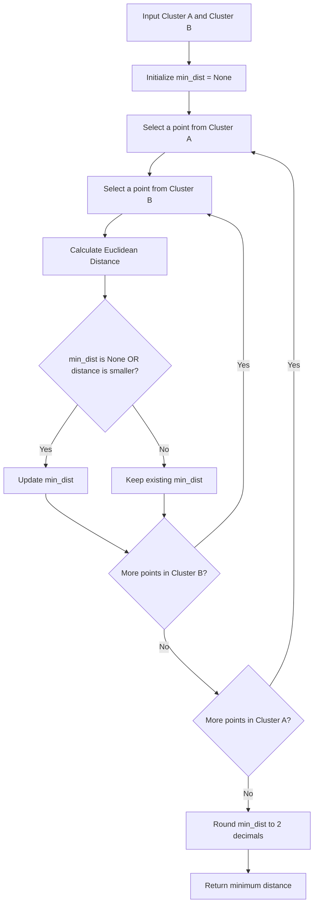

<details>
<summary><b>Q.1 Which method in Hierarchical Clustering merges the clusters with minimum distance between any pair of points?</b></summary>

**A.** Average Linkage

**B.** Complete Linkage

**C.** Single Linkage

**D.** Centroid Linkage

<details>
<summary><b>Answer</b></summary>

**Correct Answer: Option C**

**Single Linkage**

### Explanation

Single Linkage is a linkage criterion used in Agglomerative Hierarchical Clustering.

It calculates the minimum distance between any pair of data points belonging to two different clusters.

The two clusters having the smallest minimum distance are merged together.

### Mathematical formula

$$d(C_i,C_j)=\min_{x\in C_i,\ y\in C_j}d(x,y)$$

Where:

- $C_i$ and $C_j$ = Two different clusters.
- $x$ = A data point belonging to Cluster $C_i$.
- $y$ = A data point belonging to Cluster $C_j$.
- $d(x,y)$ = Distance between two data points.

### Numerical example

Suppose we have two clusters:

**Cluster A:**

```python
A = [1, 2, 3]
```

**Cluster B:**

```python
B = [8, 10, 12]
```

Assume these are points on a one-dimensional axis and we use Euclidean distance.

Let's calculate all pairwise distances:

| Cluster A | Cluster B | Distance |
|---:|---:|---:|
| 1 | 8 | 7 |
| 1 | 10 | 9 |
| 1 | 12 | 11 |
| 2 | 8 | 6 |
| 2 | 10 | 8 |
| 2 | 12 | 10 |
| 3 | 8 | 5 |
| 3 | 10 | 7 |
| 3 | 12 | 9 |

The minimum distance is 5.

Therefore:

$$Single\ Linkage = \boxed{5}$$

Single Linkage considers only the closest pair of points between the two clusters.

### Understanding different linkage methods

| Linkage Method | Distance Calculation |
|---|---|
| Single Linkage | Minimum pairwise distance |
| Complete Linkage | Maximum pairwise distance |
| Average Linkage | Average of all pairwise distances |
| Centroid Linkage | Distance between cluster centroids |

### Why are the other options incorrect?

- **A. Average Linkage:** Calculates the average distance between all pairs of points belonging to two clusters.
- **B. Complete Linkage:** Calculates the maximum distance between any pair of points belonging to two clusters.
- **C. Single Linkage:** Correct. Calculates the minimum distance between any pair of points belonging to two clusters.
- **D. Centroid Linkage:** Calculates the distance between the centroids (means) of two clusters.

### Interview takeaway

Remember these four linkage methods:

- **Single:** Minimum distance (closest points).
- **Complete:** Maximum distance (farthest points).
- **Average:** Average distance (all pairs).
- **Centroid:** Distance between cluster means.

**Ultimate intuition:** Single Linkage merges two clusters if even one pair of points, one from each cluster, is sufficiently close.

**Important:** Single Linkage is prone to the chaining effect, where clusters can gradually merge through a sequence of nearby points, even when the overall clusters are far apart.

</details>
</details>

---


<details>
<summary><b>Q.2 What's the output of the following code if the input data has 5 samples?</b></summary>

```python
from scipy.cluster.hierarchy import linkage

link_matrix = linkage(data, method='ward')

link_matrix.shape
```

**A.** (4, 2)

**B.** (4, 3)

**C.** (5, 3)

**D.** (4, 4)

<details>
<summary><b>Answer</b></summary>

**Correct Answer: Option D**

**Output: (4, 4)**

### Explanation

This question tests our understanding of the `linkage()` function in SciPy and the structure of the linkage matrix generated by Hierarchical Clustering.

In Agglomerative Hierarchical Clustering:

- Initially, every data point is treated as an individual cluster.
- At every iteration, two clusters are merged.
- The process continues until all data points become one cluster.

For N data points, we need exactly N - 1 merging operations to combine all points into one cluster.

### Why?

We are given:

```python
data = 5 samples
```

**Step 1: Calculate the number of merging operations**

Initially, we have 5 individual clusters.

Every merging operation reduces the number of clusters by one.

$$\text{Merges} = N - 1 = 5 - 1 = 4$$

Therefore, the linkage matrix will contain 4 rows.

**Step 2: Understand the structure of the linkage matrix**

The `linkage()` function returns a matrix with four columns.

Each row represents one merging operation.

The four columns represent:

| Column | Meaning |
|---|---|
| Column 1 | Index of the first cluster being merged |
| Column 2 | Index of the second cluster being merged |
| Column 3 | Distance at which the clusters are merged |
| Column 4 | Number of original observations contained in the newly formed cluster |

Therefore, the linkage matrix has:

- 4 rows (merging operations).
- 4 columns (information about each merging operation).

**Step 3: Understand link_matrix.shape**

```python
link_matrix.shape
```

The `.shape` attribute returns a tuple representing the dimensions of a NumPy array.

Therefore:

```python
(4, 4)
```

### Why are the other options incorrect?

- **A. (4, 2):** Incorrect. Each merging operation contains four pieces of information, not two.
- **B. (4, 3):** Incorrect. The linkage matrix contains four columns, including the number of observations in the newly formed cluster.
- **C. (5, 3):** Incorrect. Five samples require four merging operations, not five.
- **D. (4, 4):** Correct. Five samples produce four merging operations, and each operation contains four columns.

### Interview takeaway

Remember these two important rules for SciPy's `linkage()` function:

$$\text{Rows} = N - 1$$

$$\text{Columns} = 4$$

Therefore:

$$\boxed{\text{Shape} = (N-1,\ 4)}$$

**Ultimate intuition:** With N data points, Agglomerative Hierarchical Clustering performs N - 1 merges to combine all points into one cluster. SciPy records every merge using four pieces of information.

**Important:** The `method='ward'` parameter specifies Ward's linkage criterion, which minimizes the increase in within-cluster variance at each merging step. It does not change the shape of the linkage matrix.

</details>
</details>

---


<details>
<summary><b>Q.3 A hospital's data science team is clustering ICU patients' vital-sign readings (heart rate, blood pressure) to find groups of patients with similar risk profiles. When they used single linkage, they got one enormous cluster with several tiny 1–2 patient clusters hanging off the side — clinicians said this wasn't clinically useful. Which linkage method should the team switch to, and why?</b></summary>

**A.** Stick with single linkage — it always produces the tightest, most reliable clusters.

**B.** Switch to complete linkage — it discourages long chains and produces more compact clusters.

**C.** Switch to average linkage — it balances distances and produces more stable, balanced clusters.

**D.** No linkage method will fix this — they must reduce the number of patients first.

<details>
<summary><b>Answer</b></summary>

**Correct Answer: Option B**

**Switch to complete linkage — it discourages long chains and produces more compact clusters.**

### Explanation

This question tests our understanding of the **Chaining Effect in Single Linkage** and how Complete Linkage helps overcome this limitation.

In Hierarchical Clustering, different linkage methods determine how the distance between two clusters is calculated.

Single Linkage considers the minimum distance between any pair of points belonging to two different clusters.

Because of this, even if just one pair of points is close, two clusters can merge.

This can create a chaining effect, where clusters gradually connect through a sequence of nearby points, resulting in one large, elongated cluster.

### Why?

Let's understand the difference using a numerical example.

Suppose we have two clusters:

**Cluster A:**

```python
A = [1, 2, 3]
```

**Cluster B:**

```python
B = [4, 5, 20]
```

Assume these are one-dimensional points and we use Euclidean distance.

Let's calculate the pairwise distances:

| Cluster A | Cluster B | Distance |
|---:|---:|---:|
| 1 | 4 | 3 |
| 1 | 5 | 4 |
| 1 | 20 | 19 |
| 2 | 4 | 2 |
| 2 | 5 | 3 |
| 2 | 20 | 18 |
| 3 | 4 | 1 |
| 3 | 5 | 2 |
| 3 | 20 | 17 |

**1. Single Linkage**

Single Linkage considers the minimum pairwise distance.

$$Single\ Linkage = \min(3,4,19,2,3,18,1,2,17) = 1$$

It considers the two clusters very close because at least one pair of points is close.

**2. Complete Linkage**

Complete Linkage considers the maximum pairwise distance.

$$Complete\ Linkage = \max(3,4,19,2,3,18,1,2,17) = 19$$

It considers the clusters far apart because their farthest pair of points is separated by 19 units.

Therefore, Complete Linkage discourages merging clusters that have points spread far apart.

### Why does Complete Linkage reduce the chaining effect?

- It considers the farthest pair of points between two clusters.
- A single close pair cannot make two widely spread clusters appear close.
- It encourages compact clusters with relatively smaller diameters.
- It reduces the tendency to create long, elongated chains.

### Comparison of linkage methods

| Linkage Method | Distance Considered | Behavior |
|---|---|---|
| Single Linkage | Minimum distance | Prone to chaining |
| Complete Linkage | Maximum distance | Produces compact clusters |
| Average Linkage | Average distance | Balances pairwise distances |
| Centroid Linkage | Distance between centroids | Compares cluster centers |

### Why are the other options incorrect?

- **A. Stick with Single Linkage:** Incorrect. Single Linkage is precisely the method responsible for the chaining effect described in the question.
- **B. Switch to Complete Linkage:** Correct. It considers the maximum pairwise distance and discourages merging clusters connected only through a few nearby points.
- **C. Switch to Average Linkage:** Although Average Linkage can also reduce chaining compared with Single Linkage, Complete Linkage is the more direct choice when the objective is to discourage long chains and produce compact clusters.
- **D. Reduce the number of patients:** Incorrect. The problem is related to the linkage criterion, not simply the number of observations.

### Interview takeaway

Remember:

- **Single Linkage:** Minimum distance → Chaining effect.
- **Complete Linkage:** Maximum distance → Compact clusters.
- **Average Linkage:** Average distance → Balanced merging behavior.
- **Centroid Linkage:** Centroid-to-centroid distance → Compares cluster centers.

**Ultimate intuition:** Single Linkage asks, "Are any two points close?"

Complete Linkage asks, "Are even the farthest two points reasonably close?"

This difference makes Complete Linkage less prone to the chaining effect.

</details>
</details>

---


<details>
<summary><b>Q.4 A retail analytics intern builds a dendrogram from 20 different "reason for return" categories on an e-commerce platform. They draw one horizontal line across the dendrogram and count that it crosses 5 vertical lines. What can the intern correctly conclude from this?</b></summary>

**A.** There are exactly 5 original data points (return categories) in the dataset.

**B.** Cutting the dendrogram at that height produces 5 clusters.

**C.** There must be exactly 5 outliers in the dataset.

**D.** Ward linkage was definitely used, because the count came out to 5.

<details>
<summary><b>Answer</b></summary>

**Correct Answer: Option B**

**Cutting the dendrogram at that height produces 5 clusters.**

### Explanation

A dendrogram is a tree-like visualization used in Hierarchical Clustering to represent how individual data points or clusters are progressively merged.

One important property of a dendrogram is that we can determine the number of clusters by drawing a horizontal line at a particular height.

**Rule: The number of vertical branches intersected by a horizontal cut represents the number of clusters at that height.**

### Why?

We are given:

- Total original data points = 20.
- A horizontal line is drawn across the dendrogram.
- The horizontal line intersects 5 vertical branches.

Therefore, the number of clusters at that particular cutting height is 5.

$$\boxed{\text{Number of Clusters} = \text{Number of Vertical Intersections}}$$

### Visualization

<AsyncImage query="hierarchical clustering dendrogram horizontal cut line intersects five vertical branches five clusters labeled" aspectRatio="16:9" width="100%" fit="contain"/>

Let's understand the process:

1. Initially, all 20 data points are treated as individual clusters.
2. Hierarchical Clustering progressively merges the closest clusters.
3. We draw a horizontal line at a selected height.
4. We count how many vertical branches the line intersects.
5. That count gives the number of clusters remaining at that cutting height.

In this question:

$$\boxed{\text{Number of Clusters} = 5}$$

### Why are the other options incorrect?

- **A. Exactly 5 original data points:** Incorrect. The dataset contains 20 original data points. The number of intersections tells us the number of clusters, not the number of original observations.
- **B. Cutting produces 5 clusters:** Correct. Five vertical branch intersections indicate five clusters.
- **C. Exactly 5 outliers:** Incorrect. The number of branch intersections does not indicate the number of outliers.
- **D. Ward linkage was used:** Incorrect. The number of clusters obtained from a horizontal cut does not identify the linkage method. Single, Complete, Average and Ward linkage can all produce dendrograms.

### Interview takeaway

Remember these three concepts:

- **Leaves:** Represent original data points or observations.
- **Horizontal cut:** Determines where we stop merging clusters.
- **Vertical intersections:** Determine the number of clusters at that cutting height.

**Ultimate intuition:** Imagine cutting a tree horizontally. Every separate branch remaining above the cut represents one cluster.

</details>
</details>

---


<details>
<summary><b>Q.5 Wildlife Herd Merge Check (Single-Linkage Distance)</b></summary>

### Problem Statement

A wildlife conservation team is tracking elephant sightings in a national park. Each sighting is logged as `(x, y)` coordinates in kilometers from a base camp.

After running Hierarchical Clustering, the team splits the sightings into two candidate sub-herds, A and B.

Before deciding whether these are genuinely two separate herds or just one herd that got split too early, the team wants to compute the **Single-Linkage Distance** between the two groups.

A small distance suggests the sub-herds should be merged back together.

### Task

Write a Python function `single_linkage_distance(cluster_a, cluster_b)` that returns the minimum Euclidean distance between any point in `cluster_a` and any point in `cluster_b`.

### Function Inputs

- `cluster_a`: List of 2D coordinate tuples `(x, y)` representing sightings in sub-herd A.
- `cluster_b`: List of 2D coordinate tuples `(x, y)` representing sightings in sub-herd B.

### Function Output

A single float rounded to 2 decimal places, representing the minimum Euclidean distance between the two groups.

### Sample Input

```python
cluster_a = [(0, 0), (1, 1)]
cluster_b = [(5, 5), (2, 2)]
```

### Sample Output

```python
1.41
```

<details>
<summary><b>Answer</b></summary>

### 1. Understanding the problem

Single Linkage calculates the minimum distance between any pair of points belonging to two different clusters.

Suppose:

- Cluster A contains 2 points.
- Cluster B contains 2 points.

We need to calculate all possible cross-cluster distances.

The number of distance calculations will be:

$$2 \times 2 = 4$$

After calculating all four distances, we select the minimum one.

### 2. Mathematical formula

For two points P and Q in a 2D space, Euclidean Distance is:

$$d(P,Q)=\sqrt{(x_2-x_1)^2+(y_2-y_1)^2}$$

Single Linkage Distance is:

$$SL(A,B)=\min_{p\in A,\ q\in B}d(p,q)$$

### 3. Python implementation

```python
def single_linkage_distance(cluster_a, cluster_b):

    # 1. Initialize minimum distance
    min_dist = None

    # 2. Iterate through every point in cluster_a
    for point_a in cluster_a:

        # 3. Iterate through every point in cluster_b
        for point_b in cluster_b:

            # 4. Calculate Euclidean distance
            distance = ((point_a[0] - point_b[0]) ** 2 +
                        (point_a[1] - point_b[1]) ** 2) ** 0.5

            # 5. Update minimum distance
            if min_dist is None or distance < min_dist:
                min_dist = distance

    # 6. Return minimum distance rounded to 2 decimals
    return round(min_dist, 2)
```

### 4. Understanding the implementation step by step

**Step 1: Initialize minimum distance**

```python
min_dist = None
```

We initialize `min_dist` with `None` because initially, we haven't calculated any distance.

Why not initialize it with zero?

Because we are searching for the minimum distance. If we initialize it with zero, no positive distance can be smaller than zero.

Using `None` indicates that we haven't found any distance yet.

**Step 2: Iterate through Cluster A**

```python
for point_a in cluster_a:
```

This loop visits every point in Cluster A.

**Step 3: Iterate through Cluster B**

```python
for point_b in cluster_b:
```

For every point in Cluster A, we compare it with every point in Cluster B.

This nested loop ensures that no possible cross-cluster pair is missed.

**Step 4: Calculate Euclidean distance**

```python
distance = ((point_a[0] - point_b[0]) ** 2 +
            (point_a[1] - point_b[1]) ** 2) ** 0.5
```

We calculate the straight-line distance between the two points.

Here:
- `point_a[0]` and `point_b[0]` represent X coordinates.
- `point_a[1]` and `point_b[1]` represent Y coordinates.
- `** 2` calculates the square of the difference.
- `** 0.5` calculates the square root.

**Step 5: Update minimum distance**

```python
if min_dist is None or distance < min_dist:
    min_dist = distance
```

Two conditions are checked:

1. If `min_dist is None`, this is our first calculated distance. Store it.
2. If the newly calculated distance is smaller than the existing minimum, update `min_dist`.

Otherwise, retain the previous minimum.

**Step 6: Return rounded distance**

```python
return round(min_dist, 2)
```

Finally, we round the minimum distance to two decimal places as required by the assignment.

### 5. Numerical dry run

Given:

```python
cluster_a = [(0, 0), (1, 1)]
cluster_b = [(5, 5), (2, 2)]
```

We calculate every possible pairwise distance.

| Point A | Point B | Euclidean Distance |
|---|---|---:|
| (0, 0) | (5, 5) | 7.07 |
| (0, 0) | (2, 2) | 2.83 |
| (1, 1) | (5, 5) | 5.66 |
| (1, 1) | (2, 2) | 1.41 |

Let's understand the minimum calculation:

**First comparison:**

Distance between (0, 0) and (5, 5):

$$d=\sqrt{(5-0)^2+(5-0)^2}=7.07$$

Since `min_dist` is initially `None`:

```python
min_dist = 7.07
```

**Second comparison:**

Distance between (0, 0) and (2, 2):

$$d=\sqrt{(2-0)^2+(2-0)^2}=2.83$$

Since 2.83 is smaller than 7.07:

```python
min_dist = 2.83
```

**Third comparison:**

Distance between (1, 1) and (5, 5):

$$d=\sqrt{(5-1)^2+(5-1)^2}=5.66$$

Since 5.66 is greater than 2.83, we retain:

```python
min_dist = 2.83
```

**Fourth comparison:**

Distance between (1, 1) and (2, 2):

$$d=\sqrt{(2-1)^2+(2-1)^2}=1.41$$

Since 1.41 is smaller than 2.83:

```python
min_dist = 1.41
```

Therefore, the final result is:

```python
1.41
```

### 6. Complete execution flow



### 7. Time and Space Complexity

Let:

- M = Number of points in Cluster A.
- N = Number of points in Cluster B.

Time Complexity

We compare every point in Cluster A with every point in Cluster B.

$$T(M,N)=O(M\times N)$$

Space Complexity

We only maintain a few variables (`min_dist` and `distance`).

We don't create any additional list or data structure.

$$S(M,N)=O(1)$$

### 8. Interview takeaway

Remember:

- Single Linkage → Minimum pairwise distance.
- Complete Linkage → Maximum pairwise distance.
- Average Linkage → Average pairwise distance.
- Centroid Linkage → Distance between cluster centroids.

Ultimate intuition: Single Linkage finds the closest connection between two clusters. Even if most points are far apart, one close pair can make the two clusters eligible for merging.

Important implementation detail: This implementation assumes both clusters contain at least one point, as the assignment does not specify behavior for empty clusters.

</details>
</details>

