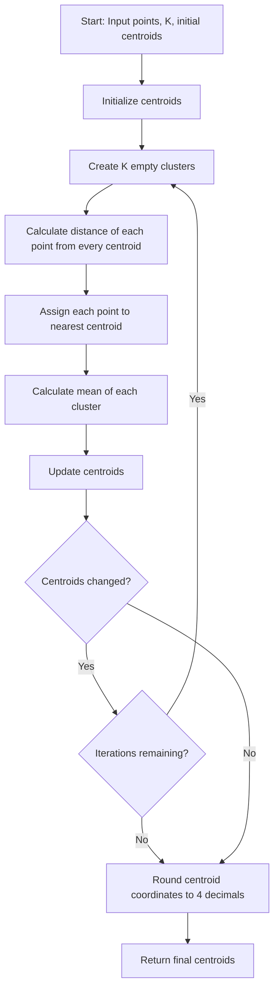

<details>
<summary><b>Q. Implement the K-Means Clustering Algorithm from Scratch</b></summary>

### Problem Statement

Your task is to write a Python function that implements the K-Means clustering algorithm.

K-Means is an unsupervised learning technique that groups similar data points based on their proximity (using Euclidean distance) to iteratively refined cluster centers called centroids.

The function should:

1. Assign each point to its nearest centroid.
2. Recalculate centroids as the mean of their assigned points.
3. Repeat for a given number of iterations or until convergence.
4. Round each coordinate of the final centroids to 4 decimal places.

### Function Inputs

- `points`: A list of tuples, where each tuple represents a 2D point `(x, y)`.
- `k`: An integer representing the number of clusters.
- `initial_centroids`: A list of K 2D tuples, serving as starting centroids.
- `max_iterations`: Maximum number of iterations to perform.

### Function Output

A list of K 2D tuples representing the final centroids, rounded to 4 decimal places.

### Sample Input

```python
points = [
    (1, 2), (1, 4), (1, 0),
    (10, 2), (10, 4), (10, 0)
]

k = 2

initial_centroids = [(1, 1), (10, 1)]

max_iterations = 10
```

### Sample Output

```python
[(1.0, 2.0), (10.0, 2.0)]
```

<details>
<summary><b>Answer</b></summary>

### 1. Understanding the problem

Before writing code, let's understand what we need to implement.

K-Means follows two major operations repeatedly:

**Step 1: Assignment Step**

Assign every data point to its nearest centroid using Euclidean distance.

**Step 2: Update Step**

Calculate the mean of all data points belonging to each cluster. This mean becomes the new centroid.

We repeat these two operations until:
- The centroids stop changing (convergence).
- OR the maximum number of iterations is reached.

### 2. Python implementation

```python
def kmeans(points, k, initial_centroids, max_iterations):

    # 1. Initialize centroids
    centroids = list(initial_centroids)

    for _ in range(max_iterations):

        # 2. Assign points to the nearest centroid
        clusters = [[] for _ in range(k)]

        for point in points:

            distances = [
                ((point[0] - cx) ** 2 + (point[1] - cy) ** 2)
                for cx, cy in centroids
            ]

            nearest_cluster = distances.index(min(distances))

            clusters[nearest_cluster].append(point)

        # 3. Update centroids using cluster means
        new_centroids = []

        for i in range(k):

            if clusters[i]:

                x_mean = sum(p[0] for p in clusters[i]) / len(clusters[i])
                y_mean = sum(p[1] for p in clusters[i]) / len(clusters[i])

                new_centroids.append((x_mean, y_mean))

            else:
                # Retain the previous centroid if cluster is empty
                new_centroids.append(centroids[i])

        # 4. Check convergence
        if new_centroids == centroids:
            centroids = new_centroids
            break

        # 5. Update centroids for next iteration
        centroids = new_centroids

    # 6. Return centroids rounded to 4 decimal places
    return [(round(x, 4), round(y, 4)) for x, y in centroids]
```

### 3. Understanding the implementation step by step

#### Step 1: Initialize centroids

```python
centroids = list(initial_centroids)
```

We start with the initial centroids provided as input.

Initially:

```python
centroids = [(1, 1), (10, 1)]
```

We have two clusters, so we have two initial centroids.

#### Step 2: Create empty clusters

```python
clusters = [[] for _ in range(k)]
```

We create K empty lists to store the data points assigned to each cluster.

For K = 2:

```python
clusters = [[], []]
```

- `clusters[0]` stores points belonging to Cluster 0.
- `clusters[1]` stores points belonging to Cluster 1.

#### Step 3: Calculate Euclidean distances

```python
distances = [
    ((point[0] - cx) ** 2 + (point[1] - cy) ** 2)
    for cx, cy in centroids
]
```

For every data point, we calculate its squared Euclidean distance from each centroid.

Mathematically:

\[
d(P,C)=\sqrt{(x_1-x_2)^2+(y_1-y_2)^2}
\]

**Important:** We are calculating squared Euclidean distance without taking the square root.

This is valid because square root is a monotonically increasing function for non-negative values. Therefore, the nearest centroid remains the same.

#### Step 4: Find the nearest centroid

```python
nearest_cluster = distances.index(min(distances))
```

- `min(distances)` finds the smallest distance.
- `.index()` returns the index of that minimum value.

That index identifies the nearest centroid.

#### Step 5: Assign the point to its cluster

```python
clusters[nearest_cluster].append(point)
```

We append the data point to the corresponding cluster.

After processing all six points:

```python
clusters = [
    [(1, 2), (1, 4), (1, 0)],
    [(10, 2), (10, 4), (10, 0)]
]
```

#### Step 6: Update centroids

```python
x_mean = sum(p[0] for p in clusters[i]) / len(clusters[i])

y_mean = sum(p[1] for p in clusters[i]) / len(clusters[i])
```

We calculate the mean independently for both dimensions.

**Cluster 0:**

Points:

```python
[(1, 2), (1, 4), (1, 0)]
```

X-coordinate mean:

\[
\frac{1+1+1}{3}=1
\]

Y-coordinate mean:

\[
\frac{2+4+0}{3}=2
\]

New centroid:

\[
\mu_0=(1,2)
\]

**Cluster 1:**

Points:

```python
[(10, 2), (10, 4), (10, 0)]
```

X-coordinate mean:

\[
\frac{10+10+10}{3}=10
\]

Y-coordinate mean:

\[
\frac{2+4+0}{3}=2
\]

New centroid:

\[
\mu_1=(10,2)
\]

Therefore:

```python
new_centroids = [(1, 2), (10, 2)]
```

#### Step 7: Check convergence

```python
if new_centroids == centroids:
    centroids = new_centroids
    break
```

We compare the newly calculated centroids with the previous centroids.

- If they are identical, the algorithm has converged.
- Otherwise, we continue with another iteration.

#### Step 8: Return final centroids

```python
return [(round(x, 4), round(y, 4)) for x, y in centroids]
```

The assignment requires each centroid coordinate to be rounded to four decimal places.

### 4. Complete execution flow

```text
<CodeBlock language="mermaid" editable>
flowchart TD
    A["Start: Input points, K, initial centroids"] --> B["Initialize centroids"]
    B --> C["Create K empty clusters"]
    C --> D["Calculate distance of each point from every centroid"]
    D --> E["Assign each point to nearest centroid"]
    E --> F["Calculate mean of each cluster"]
    F --> G["Update centroids"]
    G --> H{"Centroids changed?"}
    H -->|"Yes"| I{"Iterations remaining?"}
    I -->|"Yes"| C
    I -->|"No"| J["Round centroid coordinates to 4 decimals"]
    H -->|"No"| J
    J --> K["Return final centroids"]
```


### 5. Time and Space Complexity

Let:

- N = Number of data points.
- K = Number of clusters.
- D = Number of features (2 in this assignment).
- I = Number of iterations.

| Operation                           | Time Complexity  |
| ----------------------------------- | ---------------- |
| Distance calculation and assignment | O(N × K × D)     |
| Centroid update                     | O(N × D)         |
| Total per iteration                 | O(N × K × D)     |
| All iterations                      | O(I × N × K × D) |

Overall Time Complexity:

\\[ \boxed{O(I \times N \times K \times D)} \\]

Space Complexity:

\\[ \boxed{O(N+K\times D)} \\]

We store the cluster assignments for N points and K centroids, each having D dimensions.

### 6. Important implementation notes

- Empty clusters: The assignment does not specify what to do if a cluster receives no points. Our implementation retains its previous centroid in that situation.
- Convergence: We compare centroid coordinates without rounding. Rounding is performed only when returning the final result.
- Distance: Squared Euclidean distance is sufficient for finding the nearest centroid.
- Initialization: We use the supplied initial centroids rather than generating random ones.

### Interview takeaway

K-Means implementation revolves around two fundamental operations:

1. Assignment: Assign every data point to its nearest centroid.
2. Update: Recalculate each centroid using the mean of its assigned data points.

Repeat these operations until convergence or the maximum iteration limit is reached.

Ultimate intuition: K-Means repeatedly improves cluster membership and cluster centers until the grouping becomes stable.

One important distinction: This assignment provides initial centroids as input. Therefore, we are implementing the core K-Means algorithm, not the K-Means++ initialization procedure.

</details>
</details>


    
