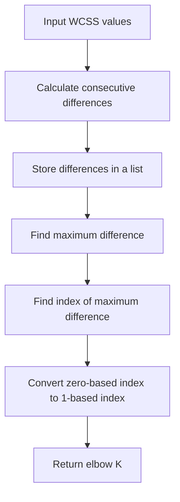

<details>
<summary><b>Q. Implement the Elbow Method to Find Optimal K</b></summary>

### Problem Statement

Your task is to implement a Python function that takes a list of WCSS (Within-Cluster Sum of Squares) values computed for increasing values of K and returns the optimal K using the Elbow Method.

The elbow point is defined by this assignment as the index with the maximum drop in WCSS compared to the next value.

### Function Input

- `wcss_values`: A list of floats representing WCSS values for K = 1 to N.

### Function Output

An integer representing the elbow point (1-based index).

### Sample Input

```python
wcss_values = [1000.0, 500.0, 300.0, 250.0, 240.0]
```

### Sample Output

```python
1
```

<details>
<summary><b>Answer</b></summary>

**Correct Answer: 1**

### 1. Understanding the problem

The objective is to identify the position where WCSS experiences its maximum reduction as the number of clusters (K) increases.

Remember:

- WCSS measures the sum of squared distances between data points and their assigned centroids.
- As K increases, WCSS generally decreases.
- The Elbow Method identifies a reasonable K by observing where the reduction in WCSS starts becoming smaller.

For this assignment, we specifically need to find the **maximum drop between two consecutive WCSS values**.

### 2. Mathematical intuition

Suppose we have:

```python
wcss_values = [1000, 500, 300, 250, 240]
```

We calculate the reduction between consecutive values.

The mathematical formula is:

$$
Drop_i = WCSS_i - WCSS_{i+1}
$$

Where:
- $WCSS_i$ = WCSS value at position i.
- $WCSS_{i+1}$ = WCSS value at the next position.
- $Drop_i$ = Reduction in WCSS between consecutive values.

### 3. Calculate the WCSS differences

| K transition | WCSS reduction |
|---|---:|
| K = 1 → 2 | 1000 - 500 = 500 |
| K = 2 → 3 | 500 - 300 = 200 |
| K = 3 → 4 | 300 - 250 = 50 |
| K = 4 → 5 | 250 - 240 = 10 |

The maximum reduction is 500, which occurs between K = 1 and K = 2.

Therefore, according to the assignment's indexing convention, the answer is:

$$
\boxed{Elbow\ K = 1}
$$

### 4. Python implementation

```python
def find_elbow(wcss_values):

    # 1. Calculate the drop between consecutive WCSS values
    drops = []

    for i in range(len(wcss_values) - 1):
        drop = wcss_values[i] - wcss_values[i + 1]
        drops.append(drop)

    # 2. Find the position of the maximum drop
    max_drop_index = drops.index(max(drops))

    # 3. Convert zero-based index into 1-based index
    elbow_k = max_drop_index + 1

    return elbow_k
```

### 5. Understanding the implementation step by step

**Step 1: Calculate consecutive WCSS differences**

```python
drops = []

for i in range(len(wcss_values) - 1):
    drop = wcss_values[i] - wcss_values[i + 1]
    drops.append(drop)
```

We iterate through the WCSS list and calculate the difference between consecutive elements.

For our example:

```python
wcss_values = [1000, 500, 300, 250, 240]
```

The resulting list is:

```python
drops = [500, 200, 50, 10]
```

Notice that we use:

```python
range(len(wcss_values) - 1)
```

We subtract 1 because every element is compared with its next element.

Otherwise, the final iteration would attempt to access an index that doesn't exist.

**Step 2: Find the maximum drop**

```python
max_drop_index = drops.index(max(drops))
```

Two operations happen here:

- `max(drops)` → Finds the maximum reduction.
- `drops.index()` → Returns the zero-based index of that reduction.

For our example:

```python
max(drops) = 500
```

And:

```python
drops.index(500) = 0
```

**Step 3: Convert to 1-based indexing**

```python
elbow_k = max_drop_index + 1
```

Python uses zero-based indexing, but the assignment expects a 1-based index.

Therefore:

$$
Elbow\ K = 0 + 1 = 1
$$

**Step 4: Return the result**

```python
return elbow_k
```

The function returns:

```python
1
```

### 6. Complete execution flow

<CodeBlock language="mermaid" editable>



### 7. Time and Space Complexity

Let N be the number of WCSS values.

| Operation                         | Time Complexity |
| --------------------------------- | --------------- |
| Calculate consecutive differences | O(N)            |
| Find maximum difference           | O(N)            |
| Find index of maximum difference  | O(N)            |
| Total                             | O(N)            |

Overall Time Complexity:

$$\
\boxed\
$$

Space Complexity:

$$\
\boxed\
$$

We create an additional list to store the consecutive WCSS differences.

### 8. Interview takeaway

Remember the three operations:

1. Calculate differences between consecutive WCSS values.
2. Find the maximum difference.
3. Return its 1-based index.

Ultimate intuition: We are identifying where WCSS experiences its largest single reduction as K increases.

Important assignment-specific note: This problem defines the answer as the index before the maximum drop. Therefore, for a drop between K = 1 and K = 2, it expects 1, not 2. This is the convention we must follow to pass the assignment.

One conceptual distinction: The assignment's simplified maximum-drop rule is not the complete mathematical definition of the Elbow Method. In practice, the elbow is identified by the change in the rate of WCSS reduction (diminishing returns), not necessarily the largest individual drop. We should remember both interpretations for interviews.

</details>
</details>
