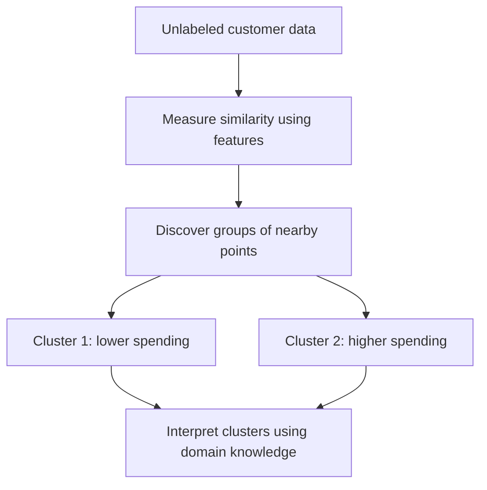
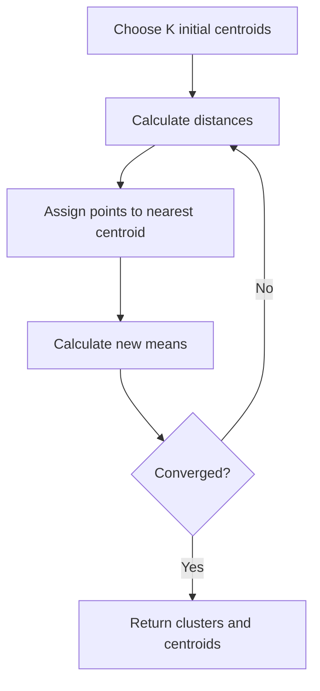
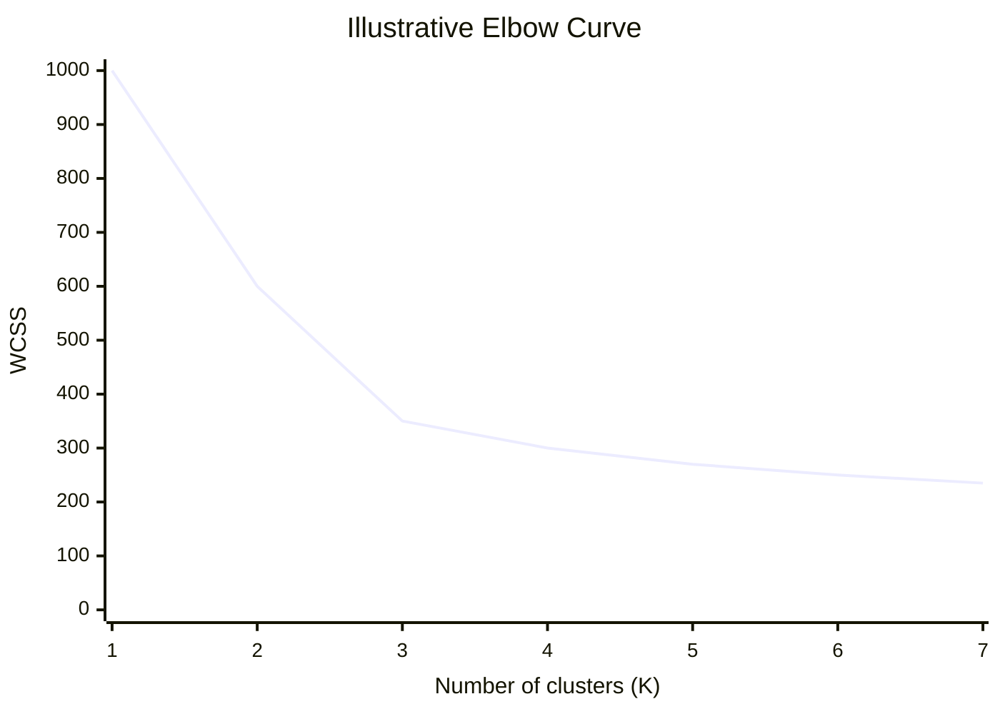

# K-Means Clustering — Master Notebook
## Unsupervised Learning | Scaler AI/ML

## 1. Ultimate Goal in ML — In Simple Terms

Imagine a grocery store has thousands of customer records. The store wants to discover groups of customers with similar purchasing behavior.

The dataset contains information such as:

- Annual spending
- Number of purchases
- Average order value

However, nobody has labeled the customers as *budget shoppers*, *regular customers*, or *premium customers*.

**K-Means helps discover groups in this unlabeled data.** After clustering, we can inspect the groups and decide what they represent.

This is called **clustering**, a task in unsupervised learning.

## 2. Supervised vs. Unsupervised Learning

In supervised learning, the model receives input features and known target labels. In unsupervised learning, the target labels for the task are not provided.

| Supervised Learning | Unsupervised Learning |
|---|---|
| Input features $X$ and target $y$ | Input features $X$, usually without target labels |
| Learns to predict a target | Discovers patterns or structure |
| Classification and regression | Clustering and dimensionality reduction |
| Example: predict customer churn | Example: discover customer segments |

Suppose our customer dataset contains these features:

| Customer | Monthly spending | Purchases per month |
|---|---:|---:|
| A | 10 | 2 |
| B | 12 | 3 |
| C | 11 | 2 |
| D | 80 | 15 |
| E | 85 | 16 |
| F | 82 | 14 |

The algorithm is not told which customers belong together. It can discover that A, B, and C are similar to one another, while D, E, and F form another group.

The cluster labels are discovered, not supplied.

## 3. What Is Clustering?

Clustering groups data points according to a chosen measure of similarity.

Two desirable properties are:

- **Low intra-cluster distance:** Points in the same cluster are relatively close.
- **High inter-cluster separation:** Different clusters are relatively distinct.

### Visual intuition

Imagine customers plotted on a graph.

- Horizontal axis: monthly spending.
- Vertical axis: purchases per month.



This is a conceptual diagram, not a guarantee that every dataset contains clearly separated groups.

**Business applications:** customer segmentation, grouping similar news articles, document analysis, and exploratory data analysis.

## 4. What Is K-Means?

K-Means is an unsupervised algorithm that partitions data into $K$ clusters.

Here, $K$ is the number of clusters we request.

- $K=2$: form two clusters.
- $K=3$: form three clusters.
- $K=5$: form five clusters.

The standard algorithm represents each cluster using a **centroid**.

### What is a centroid?

A centroid is the mean position of all the data points assigned to a cluster.

Suppose a cluster contains three points:

$$
(2,4),\quad (4,6),\quad (6,8)
$$

Calculate the mean of the x-coordinates:

$$
\mu_x=\frac{2+4+6}{3}=4
$$

Calculate the mean of the y-coordinates:

$$
\mu_y=\frac{4+6+8}{3}=6
$$

Therefore, the centroid is:

$$
\boxed{\mu=(4,6)}
$$

The mean is calculated independently for each feature. A centroid does not have to coincide with an actual data point.

### Visualizing the centroid

```text
y
8 |                 ● (6,8)
7 |
6 |         ✚ (4,6)       ← Centroid
5 |
4 | ● (2,4)
  +-------------------------- x
```

The symbol ✚ represents the calculated mean position. The centroid balances the positions of the three points.

For a dataset with $d$ features, the centroid contains $d$ coordinates.

## 5. How K-Means Works: Step by Step

[Visualization]()

K-Means repeatedly performs two operations:

1. Assign each point to its nearest centroid.
2. Recalculate each centroid using the mean of its assigned points.

### Step 1 — Initialize centroids

Choose $K$ initial centroids.

In basic random initialization, these are selected randomly from the data points.

### Step 2 — Assign points

Calculate the distance between every point and each centroid. Assign each point to its nearest centroid.

### Step 3 — Update centroids

Calculate the mean of all points assigned to each cluster.

### Step 4 — Repeat

Reassign points using the updated centroids, recalculate the means, and repeat until convergence or a stopping condition is reached.



### A complete numerical example

Consider the one-dimensional dataset:

$$
X=\{1,2,3,10,11,12\}
$$

Let $K=2$ and initialize the centroids as:

$$
\mu_1=2,\qquad \mu_2=11
$$

**Iteration 1: Assign points**

| Point | Distance to centroid 2 | Distance to centroid 11 | Assignment |
|---:|---:|---:|---|
| 1 | 1 | 10 | Cluster 1 |
| 2 | 0 | 9 | Cluster 1 |
| 3 | 1 | 8 | Cluster 1 |
| 10 | 8 | 1 | Cluster 2 |
| 11 | 9 | 0 | Cluster 2 |
| 12 | 10 | 1 | Cluster 2 |

The clusters are:

$$
C_1=\{1,2,3\}
$$

$$
C_2=\{10,11,12\}
$$

**Iteration 1: Update centroids**

$$
\mu_1=\frac{1+2+3}{3}=2
$$

$$
\mu_2=\frac{10+11+12}{3}=11
$$

The centroids have not moved, and the assignments remain unchanged. The algorithm has converged for this initialization.

### What if a centroid moves?

Suppose the initial centroids were poorly positioned. The first assignment might group points incorrectly relative to their eventual clusters.

After the mean update, the centroids move. Some points may become closer to a different centroid and change clusters. The algorithm repeats until no further improvement occurs through its standard steps.

This is the central mechanism demonstrated in the lecture.

## 6. Distance Metrics

Distance determines which centroid is nearest to a point.

### 6.1 Euclidean distance

Euclidean distance is the straight-line distance between two points.

For $p=(x_1,y_1)$ and $q=(x_2,y_2)$:

$$
d_E(p,q)=\sqrt{(x_1-x_2)^2+(y_1-y_2)^2}
$$

Example: $p=(1,2)$ and $q=(4,6)$.

$$
d_E=\sqrt{(4-1)^2+(6-2)^2}
$$

$$
=\sqrt{9+16}=\boxed{5}
$$

Standard K-Means assigns points using Euclidean distance and minimizes the sum of squared Euclidean distances.

### 6.2 Manhattan distance

Manhattan distance adds the absolute coordinate differences:

$$
d_M(p,q)=|x_1-x_2|+|y_1-y_2|
$$

For the same points:

$$
d_M=|4-1|+|6-2|=7
$$

It resembles movement along city blocks rather than directly through the city.

**Important:** Standard K-Means does not simply replace Euclidean distance with Manhattan distance. K-medians is a related algorithm that uses coordinate-wise medians to minimize absolute deviations.

### 6.3 Cosine similarity and cosine distance

Cosine similarity measures the angle between two nonzero vectors:


$$
\mathrm{cosSim}(x,y)=
\frac{x\cdot y}{|x|_2|y|_2}
$$


A common definition of cosine distance is:

$$
d_{\cos}(x,y)=1-\mathrm{cosSim}(x,y)
$$


Cosine similarity emphasizes vector direction rather than magnitude. It is useful in text analysis and embedding-based applications.

The lecture emphasizes cosine distance for high-dimensional data, especially text. The qualification is that high dimensionality alone does not make cosine distance universally best. The representation and task determine which metric is appropriate.

Standard K-Means uses Euclidean geometry by default.

## 7. Why Does K-Means Use the Mean?

The name K-Means reflects the algorithm's use of the arithmetic mean as its cluster center.

For $n$ assigned points, the mean vector is:

$$
\mu=\frac{1}{n}\sum_{i=1}^{n}x_i
$$

Why the mean?

For a fixed cluster, the mean minimizes the sum of squared Euclidean distances to a center $c$:

$$
J(c)=\sum_{i=1}^{n}\|x_i-c\|_2^2
$$

The minimizing center is:

$$
\boxed{c=\mu}
$$

This explains why the centroid-update step uses the mean. It is mathematically connected to the objective the algorithm is trying to minimize.

## 8. K-Means Objective: WCSS / Inertia

K-Means minimizes the **within-cluster sum of squares (WCSS)**:

$$
\mathrm{WCSS}=
\sum_{k=1}^{K}
\sum_{x\in C_k}
\|x-\mu_k\|_2^2
$$

Where:

- $K$ is the number of clusters.
- $C_k$ is the set of points assigned to cluster $k$.
- $\mu_k$ is the centroid of cluster $k$.
- $\|x-\mu_k\|_2^2$ is the squared Euclidean distance to that centroid.

In Scikit-learn, this objective is reported as `inertia_`.

### Numerical example

Suppose one cluster contains points $1,2,3$ and has centroid $2$.

$$
\mathrm{WCSS}=(1-2)^2+(2-2)^2+(3-2)^2
$$

$$
=1+0+1=\boxed{2}
$$

WCSS measures how tightly points are grouped around their centroids.

### Why does WCSS decrease as K increases?

More clusters allow more centroids to represent the data.

For example:

- With $K=1$, all points share one centroid.
- With $K=2$, two centroids can represent separate regions.
- With $K=N$, where $N$ is the number of data points, each point can form its own cluster and WCSS is zero.

Therefore, the smallest WCSS alone does not identify the most useful value of $K$.

## 9. Initialization Sensitivity and K-Means++

K-Means can produce different results when initialized with different centroid positions.

Poor initial positions may cause the algorithm to converge to a **local minimum**, a solution that is not necessarily the global minimum.

K-Means++ improves the initialization strategy.

### K-Means++ algorithm

1. Select the first centroid uniformly at random from the data points.
2. For each point, calculate its distance $D(x)$ to the nearest selected centroid.
3. Select the next centroid with probability proportional to $D(x)^2$.
4. Repeat until $K$ initial centroids have been selected.
5. Run standard K-Means.

The selection probability is:

$$
P(x)=\frac{D(x)^2}{\sum_{z\in X}D(z)^2}
$$

### Example

Suppose three candidate points have distances of 1, 2, and 4 from their nearest existing centroid.

| Candidate | Distance | Squared distance | Selection probability |
|---|---:|---:|---:|
| A | 1 | 1 | $1/21\approx4.8\%$ |
| B | 2 | 4 | $4/21\approx19.0\%$ |
| C | 4 | 16 | $16/21\approx76.2\%$ |

Candidate C is most likely to be selected, but it is not guaranteed to be selected.

**Critical distinction:** K-Means++ favors points farther from existing centroids; it does not always choose the farthest point. It often improves initialization, but it does not guarantee the globally optimal final clustering.

## 10. Choosing K: The Elbow Method

The Elbow Method helps select a reasonable number of clusters.

### Procedure

1. Run K-Means for different values of $K$.
2. Record the WCSS for each value.
3. Plot $K$ on the x-axis and WCSS on the y-axis.
4. Look for a bend where additional clusters produce diminishing improvements.

### Illustrative elbow curve



In this illustrative example, $K=3$ is a plausible choice because the decrease in WCSS becomes less substantial afterward.

The elbow is a heuristic, not a guarantee. Some datasets do not have a clear elbow.

## 11. Silhouette Score

The Silhouette Score evaluates how well a point fits its assigned cluster compared with its nearest alternative cluster.

$$
s=\frac{b-a}{\max(a,b)}
$$

Where:

- $a$ is the mean distance from the point to the other points in its own cluster.
- $b$ is the smallest mean distance from the point to the points in any other cluster.

### Example 1: A reasonably good assignment

Suppose:

$$
a=2,\qquad b=6
$$

Then:

$$
s=\frac{6-2}{\max(2,6)}
=\frac{4}{6}\approx0.67
$$

The point is relatively close to its own cluster and farther from its nearest neighboring cluster.

### Example 2: A potentially poor assignment

Suppose:

$$
a=5,\qquad b=4
$$

Then:

$$
s=\frac{4-5}{\max(5,4)}=-0.2
$$

The negative score suggests that the point may be closer on average to another cluster than to its assigned cluster.

### Interpretation

| Silhouette score | Interpretation |
|---|---|
| Close to $+1$ | Good cohesion and separation for the point |
| Close to $0$ | Point lies near a cluster boundary |
| Below $0$ | Potentially poor cluster assignment |

We can compare the average silhouette score for different values of $K$. Higher scores generally indicate better cohesion and separation, but they do not guarantee that the resulting clusters are meaningful for a business task.

## 12. Elbow vs. Silhouette

| Aspect | Elbow Method | Silhouette Score |
|---|---|---|
| Main measure | WCSS / inertia | Cohesion and separation |
| Desired result | A clear bend | Higher average score |
| Main question | When do extra clusters give diminishing returns? | How well do points fit their own clusters versus neighboring clusters? |
| Limitation | The elbow may be ambiguous | The score depends on cluster geometry and the chosen distance measure |

These methods complement one another. Domain knowledge and stability checks remain important.

## 13. Practical ML Considerations

### Feature scaling

Suppose the features are annual income and number of purchases. Income may have a much larger numerical range and dominate Euclidean distance.

Scaling can make the features contribute more comparably, provided that this is appropriate for the problem.

### Outliers

The mean is sensitive to extreme values. Outliers can pull centroids away from the main groups.

Investigate outliers and consider more robust methods when necessary.

### Cluster shape

K-Means generally works best with compact, approximately spherical clusters in the chosen feature space. It can struggle with curved clusters, highly different densities, and overlapping groups.

DBSCAN and hierarchical clustering may be more suitable for some datasets.

### Interpretation

Cluster IDs are arbitrary identifiers, not meaningful categories by themselves. The business interpretation comes after clustering.

## 14. Python Implementation

```python
from sklearn.preprocessing import StandardScaler
from sklearn.cluster import KMeans

# X contains the input features, without target labels.
scaler = StandardScaler()
X_scaled = scaler.fit_transform(X)

model = KMeans(
    n_clusters=3,
    init="k-means++",
    n_init=10,
    random_state=42
)

model.fit(X_scaled)

labels = model.labels_
centroids = model.cluster_centers_
inertia = model.inertia_
```

### Understanding the outputs

- `labels_`: Cluster assignment for each sample.
- `cluster_centers_`: Centroids in the scaled feature space.
- `inertia_`: WCSS for the fitted clustering.

`n_init=10` requests multiple initializations and retains the run with the lowest inertia. `random_state=42` makes the randomized procedure reproducible in this setup.

This is a standard implementation example, not a claim that the lecture used this exact code.

## 15. Time and Space Complexity

Let:

- $n$ be the number of data points.
- $K$ be the number of clusters.
- $d$ be the number of features.
- $I$ be the number of iterations.

The typical time complexity is approximately:

$$
O(nK d I)
$$

The main computation is calculating distances between data points and centroids at each iteration.

The dataset requires $O(nd)$ storage, with additional storage for centroids and cluster assignments.

Actual performance depends on the implementation, initialization, data structure, and convergence behavior.

## 16. Common Mistakes

1. Assuming K-Means automatically selects the best K.
2. Believing K-Means++ always selects the farthest point.
3. Assuming lower WCSS always means more meaningful clusters.
4. Ignoring feature scaling.
5. Assuming K-Means always finds the global optimum.
6. Treating cluster IDs as semantic labels.
7. Assuming cosine distance is the default for standard K-Means.
8. Assuming every dataset contains spherical, clearly separated clusters.

## 17. Interview Questions

**Q1. Why does K-Means use the mean?**

The mean minimizes the sum of squared Euclidean distances for fixed cluster assignments.

**Q2. Why is initialization important?**

Different initial centroids can lead to different local optima.

**Q3. How does K-Means++ work?**

It selects the first centroid randomly and chooses subsequent centroids probabilistically, favoring points farther from existing centroids.

**Q4. Why does WCSS decrease as K increases?**

Additional centroids allow points to be represented more closely, reducing the minimum achievable within-cluster sum of squares.

**Q5. Why not choose the largest K?**

It can create trivial, overly fragmented clusters that are not useful for the intended task.

**Q6. What does a negative silhouette score suggest?**

The point may be closer on average to another cluster than to its assigned cluster.

**Q7. What are K-Means' main limitations?**

It requires K in advance, is sensitive to initialization and outliers, depends on feature scaling, and can struggle with non-spherical clusters.

## 18. Quick Revision

- **Clustering:** Group similar points.
- **K-Means:** Partition data into K clusters using centroids.
- **Centroid:** Mean position of assigned points.
- **Assignment:** Choose the nearest centroid.
- **Update:** Recalculate each centroid using the mean.
- **WCSS / inertia:** Sum of squared distances to assigned centroids.
- **K-Means++:** Probabilistic initialization favoring distant points.
- **Elbow Method:** Look for diminishing returns as K increases.
- **Silhouette Score:** Evaluate cohesion and separation.
- **Feature scaling:** Important when feature ranges differ.
- **Main limitation:** K-Means may converge to a local optimum and works best for suitable cluster geometries.

### Final mental model

**Initialize → Assign → Update → Repeat → Evaluate**

K-Means optimizes a mathematical objective. Determining whether the resulting clusters are meaningful for a real-world task is a separate responsibility.

