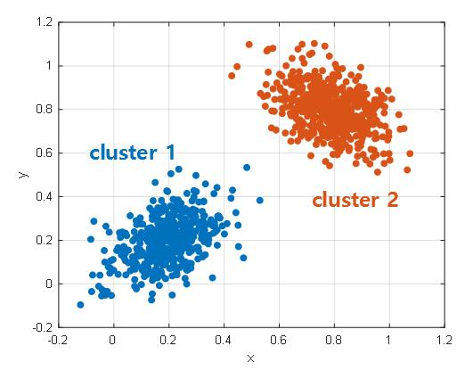
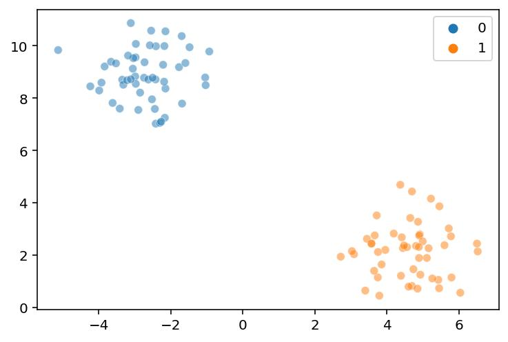

<b>What is Evaluation Metrics</b>

Friend, Evaluation Metrics are measures or criteria that help us judge how well a Machine Learning model or algorithm is performing.

In simple words:

Evaluation metrics help us answer:

"Model ne kitna achha kaam kiya?"

## 1. Real-world example

Imagine you are teaching two students for an examination.

Both students take a test:

- Student A scores 90/100.
- Student B scores 60/100.

Marks are the evaluation metric here. They help us compare their performance.

Similarly, in Machine Learning, we need evaluation metrics to measure model performance.

## 2. Evaluation Metrics in Machine Learning

Different ML problems require different evaluation metrics.

| ML Problem     | Common evaluation metrics                          |
| -------------- | -------------------------------------------------- |
| Classification | Accuracy, Precision, Recall, F1-score              |
| Regression     | MAE, MSE, RMSE, R² Score                           |
| Clustering     | Silhouette Score, Dunn Index, Davies-Bouldin Index |

Notice that evaluation metrics depend on the type of ML problem.

## 3. In our current topic: Clustering

Suppose K-Means creates three customer clusters.

But how do we know whether the clustering is good?

We don't have predefined labels (because it's unsupervised learning).

So we use Internal Evaluation Metrics:

- Silhouette Score: How well does each point fit within its cluster compared with other clusters?
- Dunn Index: How compact and separated are the clusters?
- Davies-Bouldin Index: How similar is each cluster to its most similar neighbouring cluster?

These metrics help us evaluate clustering quality without requiring predefined ground-truth labels.

## 4. Types of Clustering Evaluation

| Type                | Meaning                                                                | Example                  |
| ------------------- | ---------------------------------------------------------------------- | ------------------------ |
| Internal Evaluation | Evaluates clustering using the data and cluster assignments themselves | Silhouette, Dunn         |
| External Evaluation | Compares predicted clusters against known ground-truth labels          | Adjusted Rand Index, NMI |

For example, if we already know the correct customer categories, we can compare K-Means clusters against those known categories using external metrics.

## 5. Important distinction

Let's connect this to what we just studied:

- K-Means: Creates clusters.
- Elbow Method: Helps choose K.
- Silhouette Score: Evaluates clustering quality.
- Dunn Index: Evaluates clustering quality.

### Remember this definition for interviews

"Evaluation metrics are quantitative measures used to assess how well a machine learning model or algorithm performs with respect to a particular objective."

Ultimate goal: Building a model is not enough. We also need a reliable way to determine whether its results are useful and trustworthy.

<b>is Dunn Index, elbow method and  Silhouette Score all are evaluation metrics?</b>

Yes, friend! All three are used to evaluate clustering, but there is an important distinction:

Dunn Index and Silhouette Score are evaluation metrics, whereas the Elbow Method is a technique for selecting the number of clusters (K).

## 1. Comparison

| Technique        | Purpose             | What does it measure?                                                    |
| ---------------- | ------------------- | ------------------------------------------------------------------------ |
| Dunn Index       | Evaluate clustering | Cluster compactness and separation                                       |
| Silhouette Score | Evaluate clustering | How well each point fits its cluster compared with neighbouring clusters |
| Elbow Method     | Select optimal K    | Reduction in WCSS as K increases                                         |

## 2. Understand their roles

Elbow Method

K Selection

- Run K-Means with different K values.
- Calculate WCSS for each K.
- Find the elbow where improvement starts diminishing.

Silhouette Score

Evaluation Metric

- Measures cluster cohesion and separation.
- Range: -1 to +1.
- Higher is generally better.

Dunn Index

Evaluation Metric

- Compares minimum inter-cluster distance with maximum intra-cluster diameter.
- Higher is generally better.

## 3. How do we use them together in an industry project?

Suppose we are segmenting customers using K-Means.

1. Try different K values, such as 2, 3, 4, 5, 6.
2. Use the Elbow Method to identify candidate K values.
3. Calculate Silhouette Score and Dunn Index to evaluate clustering quality.
4. Inspect the resulting customer segments.
5. Select a solution that is both statistically reasonable and useful for the business.

Important: These techniques may suggest different K values. There is no guarantee that all three will agree. Business usefulness and domain knowledge also matter.

## 4. Interview-ready answer

If an interviewer asks whether all three are evaluation metrics, you can say:

"Silhouette Score and Dunn Index are internal clustering evaluation metrics. The Elbow Method is primarily a technique for selecting the optimal number of clusters by analysing WCSS across different K values."

Remember: Elbow → How many clusters? Silhouette and Dunn → How good are the clusters?

<b>Explain Dunn Index</b>

Friend, Dunn Index is a clustering evaluation metric used to measure how good a clustering result is.

Its main objective is to check two things:

1. Clusters should be compact — points within a cluster should be close to each other.
2. Clusters should be well separated — different clusters should be far from each other.

In simple terms:

Good clustering = Small intra-cluster distance + Large inter-cluster distance.

## 1. Intuition with an example

Imagine we have two different clustering results.

Clustering A — Good separation

Compact clusters with large separation.

Clustering B — Poor separation

Clusters are spread out and overlap.

Dunn Index helps compare these clustering results.

## 2. Dunn Index formula

Dunn Index is calculated as:

`Dunn Index = Minimum inter-cluster distance / Maximum intra-cluster diameter`

Let's understand both terms.

**A. Inter-cluster distance**

Distance between two different clusters.

We consider the minimum distance between any two points belonging to different clusters, then take the minimum across all cluster pairs.

**B. Intra-cluster diameter**

Maximum distance between any two points within the same cluster.

We calculate this for every cluster and take the maximum.

## 3. Numerical example

Suppose we have two clusters:

- Cluster A: Points (1, 1), (2, 1)
- Cluster B: Points (8, 1), (9, 1)

**Step 1: Calculate intra-cluster diameter**

For Cluster A:

`Distance = sqrt((2-1)^2 + (1-1)^2) = 1`

For Cluster B:

`Distance = sqrt((9-8)^2 + (1-1)^2) = 1`

Maximum intra-cluster diameter = 1.

**Step 2: Calculate minimum inter-cluster distance**

The closest points from the two clusters are (2, 1) and (8, 1).

`Distance = sqrt((8-2)^2 + (1-1)^2) = 6`

Minimum inter-cluster distance = 6.

**Step 3: Calculate Dunn Index**

`Dunn Index = 6 / 1 = 6`

Final Dunn Index

 **6**

## 4. How do we interpret Dunn Index?

| Dunn Index    | Interpretation                                  |
| ------------- | ----------------------------------------------- |
| Higher value  | Generally better clustering                     |
| Lower value   | Poorer compactness or separation                |
| Close to zero | Clusters may be overlapping or poorly separated |

There is no universal threshold that says a Dunn Index above a particular number is always good.

## 5. Dunn Index vs Silhouette Score

Both are internal clustering evaluation metrics, but their calculations differ.

| Feature               | Dunn Index                     | Silhouette Score                  |
| --------------------- | ------------------------------ | --------------------------------- |
| Compactness           | Maximum cluster diameter       | Average intra-cluster distance    |
| Separation            | Minimum inter-cluster distance | Distance to nearest other cluster |
| Better value          | Higher                         | Closer to +1                      |
| Sensitive to outliers | Can be highly sensitive        | Can also be affected              |

Important limitation: Dunn Index uses the worst-case cluster diameter and minimum cluster separation. A single outlier or very close pair of points can significantly reduce its value.

## 6. Interview takeaway

Remember this simple relationship:

- Dunn Index ↑ = Generally better clustering.
- Intra-cluster diameter ↓ = Better compactness.
- Inter-cluster separation ↑ = Better separation.

Ultimate goal: Dunn Index evaluates whether clusters are compact internally and sufficiently separated from each other.

One important distinction: Dunn Index is an evaluation metric, not a clustering algorithm. It does not create clusters; it evaluates clusters created by algorithms such as K-Means or hierarchical clustering.

<b>Dunn Index - Scaler Lecture</b>

I've reviewed the lecture transcript and checked its mathematical explanations against the standard definition of the Dunn Index.

The instructor explains the basic idea correctly, but there are two important points that need correction:

**1.** He calculates inter-cluster distance using centroid-to-centroid distance. That is a possible centroid-based variant, but the commonly used classical Dunn Index uses the minimum distance between data points belonging to different clusters.

**2.** His explanation that Dunn Index is not used in industry because it is non-monotonic is misleading. Non-monotonic behaviour alone is not a valid reason to reject an evaluation metric.

Let's separate what the lecture teaches from the corrections, then build the notes.

## Dunn Index — Lecture Notes

### 1. What is Dunn Index?

Dunn Index is an internal clustering evaluation metric used to evaluate the quality of clustering.

It evaluates two properties:

- Compactness: Points within the same cluster should be close to each other.
- Separation: Different clusters should be far away from each other.

The intuition:

Good clustering = Compact clusters + Well-separated clusters.

### 2. Formula

The classical Dunn Index is:

`Dunn Index = Minimum Inter-cluster Distance / Maximum Intra-cluster Diameter`

In mathematical notation:

$$DI = \frac{\delta(C_i, C_j)}{\Delta(C_k)}$$

Where:

- `δ(Cᵢ, Cⱼ)` = distance between two different clusters.
- `Δ(Cₖ)` = diameter of a cluster, i.e. maximum distance between any two points within that cluster.

Interpretation:

- Numerator measures separation.
- Denominator measures the worst-case cluster spread.

### 3. Numerical example from the lecture

The instructor gives three clusters and their inter-cluster distances:

| Cluster pair | Inter-cluster distance |
| ------------ | ---------------------- |
| C1 and C3    | 13                     |
| C2 and C3    | 15                     |
| C1 and C2    | 3                      |

Minimum inter-cluster distance:

`Min(13, 15, 3) = 3`

Now, the intra-cluster diameters are:

| Cluster | Intra-cluster diameter |
| ------- | ---------------------- |
| C1      | 5                      |
| C2      | 7                      |
| C3      | 10                     |

Maximum intra-cluster diameter:

`Max(5, 7, 10) = 10`

Therefore:

`Dunn Index = 3 / 10 = 0.3`

Lecture example — final answer

**0.3**

The calculation is mathematically correct, assuming those distances have been calculated using a consistent definition.

### 4. Important correction: How is inter-cluster distance calculated?

This is where the lecture needs clarification.

The instructor calculates the distance between centroids.

He gives these coordinates:

Cluster A

- (2, 3)
- (3, 4)
- (4, 5)

Centroid A:

`((2 + 3 + 4)/3, (3 + 4 + 5)/3)`

`= (3, 4)`

Cluster B

- (8, 9)
- (9, 10)
- (10, 11)

Centroid B:

`((8 + 9 + 10)/3, (9 + 10 + 11)/3)`

`= (9, 10)`

Now calculate centroid-to-centroid Euclidean distance:

`d = sqrt((9 - 3)^2 + (10 - 4)^2)`

`= sqrt(36 + 36)`

`= sqrt(72)`

`= 8.49 approximately`

Definition clarification

The instructor's calculation of 8.49 is correct as a centroid distance.

However, classical Dunn Index uses minimum point-to-point distance between different clusters, not necessarily centroid distance.

Let's compare:

Classical Dunn Index

[Unsupervised Learning in R: Determination of Cluster Number | by Fatih Emre Ozturk, MSc | Medium](https://images.openai.com/static-rsc-4/gYDm6LB_HzCGagecIffNj-tHi7Vcfilj9Tw2CQy4Z8lshItokTomphzwp_whZnFHiyWXitUDwPL_qC_NgVlWsuyt5WyJXR_U4qWf6jTnzWPsX_O4BznnKsOBR1vTIG1h1vQbfGqbhwcfkDPuOehoE848Ei61rn0ek5CT5j4HrLA?purpose=inline)

[medium.com](https://medium.com/%40ozturkfemre/unsupervised-learning-determination-of-cluster-number-be8842cdb11?utm_source=chatgpt.com)

Minimum distance between any point in cluster A and any point in cluster B.

Centroid-based variant

[Unsupervised Learning in R: Determination of Cluster Number | by Fatih Emre Ozturk, MSc | Medium](https://images.openai.com/static-rsc-4/tgHpeYooUz1W5vWIGemPlee4aNQS9uZxiqjBlE_FLuHi4avaJivUnd6ALa2ZqppwSzXV8mooLyR5kFsL0rA4CxhSrTQysUp4jYOxKXHrYIdYDHDbCqyIql3qEwUrXQD6Tk9BfwpT3e5vPhp5D7e12lJ_PsWJdVBf0DLcD3RwWAM?purpose=inline)

[medium.com](https://medium.com/%40ozturkfemre/unsupervised-learning-determination-of-cluster-number-be8842cdb11?utm_source=chatgpt.com)

Distance between the two cluster centroids.

Both are possible ways of defining cluster separation, but they are not interchangeable. If you use centroid distance, explicitly call it a centroid-based Dunn variant rather than the classical definition.

Similarly, intra-cluster diameter in the classical definition means the maximum pairwise distance between points within that cluster.

## 5. How to interpret Dunn Index?

The general interpretation is:

| Dunn Index    | Interpretation                                    |
| ------------- | ------------------------------------------------- |
| Higher        | Better compactness and separation                 |
| Lower         | Poorer compactness or separation                  |
| Close to zero | Very close clusters or highly spread-out clusters |

There is no universal threshold for deciding whether a Dunn Index is good.

Why does a higher value indicate better clustering?

- Higher numerator means greater separation between clusters.
- Lower denominator means smaller cluster diameter.
- Both make the ratio larger.

## 6. Can Dunn Index help us choose K?

Yes. This is another concept demonstrated in the lecture.

Suppose we calculate Dunn Index for different K values:

| K | Dunn Index |
| - | ---------- |
| 2 | 0.80       |
| 3 | 0.65       |
| 4 | 0.40       |
| 5 | 0.40       |
| 6 | 0.05       |
| 7 | 0.20       |

Dunn Index vs Number of Clusters

Illustrative values based on the lecture transcript.

00.250.50.751234567

The highest score is at K = 2.

Therefore, based on this metric and these tested K values, K = 2 is the preferred candidate.

But does this prove that two clusters are the best business solution? No.

We should also examine:

- Whether the clusters are meaningful.
- Whether the segmentation is useful for the business.
- Whether the clusters are too broad or too small.
- Whether another K gives more actionable segments.

## 7. Critical verification: Is Dunn Index not used in industry because it is non-monotonic?

This is the most misleading statement in the lecture.

The instructor says Dunn Index is not monotonic and therefore industry does not use it.

Let's understand the issue.

What does monotonic mean?

A metric is monotonic if it consistently moves in one direction as its input changes.

But Dunn Index is not expected to increase or decrease consistently as K changes.

For example:

`K = 2 → 0.80`

`K = 3 → 0.65`

`K = 4 → 0.40`

`K = 5 → 0.40`

`K = 6 → 0.05`

`K = 7 → 0.20`

It decreases and then increases.

Is that necessarily a problem? No.

Different K values create different cluster structures. There is no mathematical requirement that Dunn Index must change monotonically.

Actual limitations of Dunn Index:

1. Outlier sensitivity: A single extreme point can increase a cluster's diameter and reduce the Dunn Index.
2. Worst-case dependency: It uses minimum inter-cluster distance and maximum intra-cluster diameter. One problematic pair can strongly affect the score.
3. Computational cost: Calculating pairwise distances can become expensive for large datasets.
4. Cluster geometry: It may not represent every cluster shape equally well.

So, the accurate conclusion is:

Dunn Index is a valid clustering evaluation metric, but it has limitations. It can be used in practice, although it is not necessarily the only or preferred metric.

## 8. Dunn Index vs Silhouette Score vs Elbow Method

Let's consolidate what we've learned.

| Technique            | Main purpose        | Preferred result                      |
| -------------------- | ------------------- | ------------------------------------- |
| Elbow Method         | Help select K       | Point of diminishing WCSS improvement |
| Silhouette Score     | Evaluate clustering | Higher, closer to +1                  |
| Dunn Index           | Evaluate clustering | Higher                                |
| Davies-Bouldin Index | Evaluate clustering | Lower                                 |

These are internal evaluation approaches because they assess cluster structure without requiring ground-truth labels.

## 9. Interview-ready explanation

Question: What is Dunn Index?

"Dunn Index is an internal clustering evaluation metric that measures the ratio of minimum inter-cluster separation to maximum intra-cluster diameter. A higher Dunn Index generally indicates better clustering because it represents compact clusters with good separation."

Question: Does Dunn Index use centroid distance?

"The classical Dunn Index uses minimum point-to-point distance between different clusters and maximum pairwise distance within a cluster. Centroid distance can be used in a variant, but it is not the classical definition."

Question: Why can Dunn Index be sensitive to outliers?

"Because it uses the minimum inter-cluster distance and maximum intra-cluster diameter. A single outlier can significantly affect either of these quantities."

## 10. Scaler lecture coverage checklist

Revision checklist

8/8 covered

Definition and intuition of Dunn Index

Minimum inter-cluster distance

Maximum intra-cluster diameter

Numerical calculation: 3 / 10 = 0.3

Centroid-based distance example from lecture

Choosing K using the highest Dunn Index

Understanding non-monotonic behaviour

Limitations and outlier sensitivity

My recommendation: For your Master Notes, remember the classical point-to-point definition. Also retain the instructor's centroid-based calculation as a separate example, with the clarification above. That way, you understand both what was taught and what is mathematically standard.

