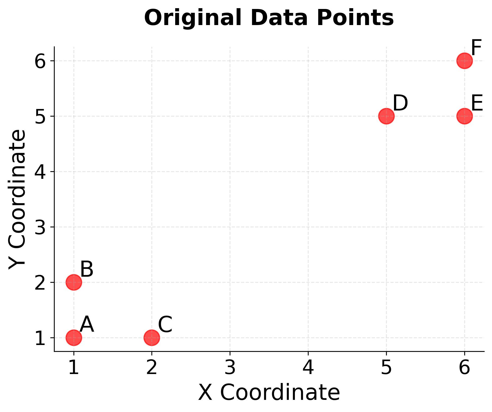

[Chat-GPT Link](https://chatgpt.com/s/t_6af08fc868288191b95dffc4a991c0a7)


# K-Means++ — Improved Centroid Initialization

## 1. What is K-Means++?

K-Means++ is an improved initialization technique for K-Means clustering.

Its purpose is to select better initial centroids so that they are more likely to be spread across the dataset.

### Why do we need it?

In standard K-Means, initial centroids are selected randomly. Sometimes, multiple centroids may be placed close to each other, resulting in poor initial clustering.

For example:


K-Means++ reduces this risk by using a distance-based probability strategy.

Important: It improves the chances of selecting good initial centroids; it does not guarantee the globally optimal clustering.

## 2. How does K-Means++ work?

Suppose we want to create $K=3$ clusters.

### Step 1: Select the first centroid randomly

Choose one data point uniformly at random from the dataset.

Every data point has an equal probability of being selected.

### Step 2: Calculate distance from the nearest selected centroid

For every data point, calculate its distance from the nearest already-selected centroid.

We represent it as:

 $$D(x_i)=\min\_{c\in C}d(x_i,c)$$

Where:

- $x_i$ = a data point.
- $C$ = set of already-selected centroids.
- $d(x_i,c)$ = distance between the data point and a centroid.
- $D(x_i)$ = distance from the nearest selected centroid.

### Step 3: Calculate the selection probability

K-Means++ selects the next centroid using a probability proportional to the square of the distance.

 $$\boxed{ P(x_i)= \frac{D(x_i)^2} {\sum\_{j=1}^{n}D(x_j)^2} }$$

This means:

- Points farther from existing centroids have a higher probability of selection.
- Points closer to existing centroids have a lower probability of selection.

Important: K-Means++ does not always select the farthest point. It uses weighted random selection.

### Step 4: Repeat the process

Repeat Steps 2 and 3 until all $K$ initial centroids have been selected.

### Step 5: Run standard K-Means

Once the initial centroids are selected, the normal K-Means algorithm starts:

1. Assign each data point to its nearest centroid.
2. Recalculate each centroid using the mean of its assigned data points.
3. Repeat assignment and centroid update until convergence.


Remember: K-Means++ only changes the centroid initialization process. The assignment and update steps remain the same as standard K-Means.

## 3. Numerical Example

Suppose we have already selected two centroids.

The distances of four candidate points from their nearest selected centroid are:

| Data point | Distance $D(x_i)$ | Squared distance |
| ---------- | --------------------- | ---------------- |
| A          | 1                     | 1                |
| B          | 2                     | 4                |
| C          | 3                     | 9                |
| D          | 4                     | 16               |
| Total      |                       | 30               |

Now calculate the probability of selecting each point:

$$P(x_i)=\frac{D(x_i)^2}{30}$$

| Data point | Probability    |
| ---------- | -------------- |
| A          | 1/30 = 3.33%   |
| B          | 4/30 = 13.33%  |
| C          | 9/30 = 30%     |
| D          | 16/30 = 53.33% |

**Selection probability**

**Point A**

3.33%

**Point B**

13.33%

**Point C**

30.00%

**Point D**

53.33%

Point D has the highest probability, but it is not guaranteed to be selected.

What do we learn?

Point D is farther away from existing centroids, so it has a higher probability of becoming the next centroid.

This encourages the initial centroids to be distributed across the dataset.

## 4. Why do we use squared distance?

There are two important reasons:

**1. Higher weight for distant points:** Squaring increases the relative importance of points that are far away.  

**2. Connection with the K-Means objective:** K-Means minimizes the sum of squared distances between data points and their assigned centroids (WCSS).

Remember the WCSS formula:

$$**WCSS=\sum\_{k=1}^{K}\sum\_{x_i\in C_k} \\|x_i-\mu_k\\|^2**$$

K-Means++ uses the same squared-distance idea during initialization.

## 5. Standard K-Means vs K-Means++

| Standard K-Means                                  | K-Means++                                                            |
| ------------------------------------------------- | -------------------------------------------------------------------- |
| Selects initial centroids randomly.               | Selects the first centroid randomly.                                 |
| Remaining centroids are also selected randomly.   | Remaining centroids are selected using distance-based probabilities. |
| Can produce poorly distributed initial centroids. | Encourages well-distributed initial centroids.                       |
| More sensitive to poor initialization.            | Reduces the risk of poor initialization.                             |

**One limitation:** K-Means++ is not an outlier-robust technique. Since it uses squared distances, an extreme outlier can receive a very high selection probability.

## 6. Does K-Means++ guarantee better clustering?

No. It improves initialization, but it does not guarantee the globally optimal solution.

There is, however, an important theoretical result from the original K-Means++ research.

Its initial seeding has an expected approximation guarantee:

$$\mathbb{E}[\phi]\leq 8(\ln K+2)\phi\_{OPT}$$

Where:

- $\phi$ = clustering cost after initialization.
- $\phi\_{OPT}$ = optimal K-Means clustering cost.
- $K$ = number of clusters.

This is an expected $O(\log K)$ approximation guarantee for the seeding cost, not a guarantee of finding the global optimum.

## 7. Time Complexity

Let:

- $n$ = number of data points.
- $K$ = number of clusters.
- $d$ = number of features.

| Operation                      | Time complexity |
| ------------------------------ | --------------- |
| One standard K-Means iteration | $O(nKd)$        |
| K-Means++ initialization       | $O(nKd)$        |

K-Means++ initialization requires additional computation compared with simply selecting random points.

However, better initialization can often reduce the number of iterations needed. This is not guaranteed for every dataset.

## 8. Python Implementation using Scikit-learn

```
from sklearn.cluster import KMeans  

model = KMeans(    n_clusters=3,    init="k-means++",    n_init=10,    random_state=42)

labels = model.fit_predict(X)  

print("Cluster Labels:")
print(labels)  

print("Centroids:")
print(model.cluster_centers_)  

print("WCSS:")
print(model.inertia_)
```

Understanding the parameters:

- `n_clusters=3`: Create three clusters.
- `init="k-means++"`: Use K-Means++ for centroid initialization.
- `n_init=10`: Run the algorithm 10 times with different initializations and keep the result with the lowest inertia.
- `random_state=42`: Make the random initialization reproducible.

Note: Recent Scikit-learn versions use `n_init="auto"` as the default. With K-Means++, this generally means one run. Here, we explicitly set it to 10.

Scikit-learn also uses a greedy variant of K-Means++ by default, which can make multiple candidate selections at each step.

## 9. Interview-Friendly Definition

K-Means++ is an improved initialization technique for K-Means clustering. It selects the first centroid randomly and selects subsequent centroids using a probability proportional to the squared distance from the nearest already-selected centroid. This encourages well-distributed initial centroids and reduces the risk of poor initialization.

## 10. Quick Revision

Remember these five points:

1. First centroid → Uniform random selection.
2. Calculate distance → Nearest selected centroid.
3. Calculate probability → Squared distance.
4. Repeat → Until K centroids are selected.
5. Run K-Means → Assignment and centroid updates.

The most important formula:

$$P(x_i)= \frac{D(x_i)^2} {\sum\_{j=1}^{n}D(x_j)^2}$$

Ultimate intuition: K-Means++ tries to avoid selecting all initial centroids from the same small region. It gives distant points a higher chance of becoming centroids, helping K-Means start with a better initial configuration.

---  

<details>
<summary><b>Q. Give a numerical example of KMeans++</b></summary>

[Chat-GPT Link](https://chatgpt.com/s/t_6af1c4dcfb948191a01afa28674c9e52)

Let's understand K-Means++ using a numerical example, step by step.

The main idea behind K-Means++ is:

> Instead of selecting all initial centroids randomly, choose the first centroid randomly and then select subsequent centroids with a higher probability for points that are farther away from the already selected centroids.

This helps spread the initial centroids across the dataset.

## 1. Consider this dataset

Suppose we have six data points in a 2D space:

| Point | Coordinates |
| ----- | ----------- |
| A     | (1, 1)      |
| B     | (2, 1)      |
| C     | (4, 3)      |
| D     | (5, 4)      |
| E     | (8, 7)      |
| F     | (9, 8)      |

We want to create 3 clusters, so $K=3$.

## 2. Step 1 — Select the first centroid randomly

Suppose K-Means++ randomly selects point A.

First centroid selected

C₁ = A = (1, 1)

<a href="https://github.com/siddharth201/MyNotes/blob/main/AI_ML/Modules/Module-5-UnsupervisedLearning/Misc/Images/KMean%2B%2B1.jpeg" target="_blank">
  
</a>

Conceptual illustration of the first centroid.

## 3. Step 2 — Calculate squared distances from the first centroid

Now calculate the squared Euclidean distance of every point from A.

Formula:

$$D(x)^2=(x_1-c_1)^2+(x_2-c_2)^2$$

Here, $D(x)$ is the distance from a data point to its nearest already-selected centroid. Since we have only one centroid, that is A.

For example, for point C = (4, 3):

$$D(C)^2=(4-1)^2+(3-1)^2$$

\\[ =9+4=13 \\]

Let's calculate for all points:

| Point | Coordinates | Squared distance from A |
| ----- | ----------- | ----------------------- |
| A     | (1, 1)      | 0                       |
| B     | (2, 1)      | 1                       |
| C     | (4, 3)      | 13                      |
| D     | (5, 4)      | 25                      |
| E     | (8, 7)      | 85                      |
| F     | (9, 8)      | 113                     |

Notice that F has the largest squared distance.

Important: K-Means++ uses squared distances, not ordinary distances, to calculate selection probabilities.

## 4. Step 3 — Calculate selection probabilities

The probability of selecting a point is:

\\[ P(x)=\frac{D(x)^2}{\sum_j D(x_j)^2} \\]

First, calculate the sum:

\\[ 0+1+13+25+85+113=237 \\]

Now calculate the probability for each point:

| Point | Squared distance | Probability |
| ----- | ---------------- | ----------- |
| A     | 0                | 0%          |
| B     | 1                | 0.42%       |
| C     | 13               | 5.49%       |
| D     | 25               | 10.55%      |
| E     | 85               | 35.86%      |
| F     | 113              | 47.68%      |
| Total | 237              | 100%        |

Probability of each point being selected as the second centroid.

0%15%30%45%60%ABCDEF

What does this tell us?

- A has 0% probability because it is already selected.
- B is very close to A, so it has a very low probability.
- E and F are far away, so they have much higher probabilities.
- F has the highest probability, but it is not guaranteed to be selected.

## 5. Step 4 — Select the second centroid

Now imagine we use a random selection process based on these probabilities.

Suppose the random selection chooses E.

Second centroid selected

C₂ = E = (8, 7)

[en.wikipedia.org](https://en.wikipedia.org/wiki/K-means%2B%2B?utm_source=chatgpt.com)

Now we have:

- C₁ = A = (1, 1)
- C₂ = E = (8, 7)

## 6. Step 5 — Calculate distances from the nearest selected centroid

Now calculate the squared distance of each point from its nearest selected centroid.

For example, for point D = (5, 4):

Distance from A:

\\[ (5-1)^2+(4-1)^2=25 \\]

Distance from E:

\\[ (5-8)^2+(4-7)^2=18 \\]

Therefore:

\\[ D(D)^2=\min(25,18)=18 \\]

Repeat for all points:

| Point | From A | From E | Minimum squared distance |
| ----- | ------ | ------ | ------------------------ |
| A     | 0      | 85     | 0                        |
| B     | 1      | 72     | 1                        |
| C     | 13     | 32     | 13                       |
| D     | 25     | 18     | 18                       |
| E     | 85     | 0      | 0                        |
| F     | 113    | 2      | 2                        |

The sum is:

\\[ 0+1+13+18+0+2=34 \\]

## 7. Step 6 — Calculate probabilities for the third centroid

Again, apply:

\\[ P(x)=\frac{D(x)^2}{\sum_jD(x_j)^2} \\]

| Point | Squared distance | Probability |
| ----- | ---------------- | ----------- |
| A     | 0                | 0%          |
| B     | 1                | 2.94%       |
| C     | 13               | 38.24%      |
| D     | 18               | 52.94%      |
| E     | 0                | 0%          |
| F     | 2                | 5.88%       |
| Total | 34               | 100%        |

Suppose the random selection chooses D.

Third centroid selected

C₃ = D = (5, 4)

[Test Run - K-Means++ Data Clustering | Microsoft Learn](https://images.openai.com/static-rsc-4/h8GqSJcnNavxveTIPJFSwM8-T41FOgmsLQOetwyxL_0ijBJ-vAlVkpLeNnARKMfLztXBxXbjKhp2PHkrVFIAsWhrUdxCoK2842VWK_SakAwcsgiH0OdCbfFSBSQ2eE0w2RkeS-rZDwYiRJfHVPTO2-ruFdhjYfw3PxKqk0kvTAM?purpose=inline)

[learn.microsoft.com](https://learn.microsoft.com/en-us/archive/msdn-magazine/2015/august/test-run-k-means-data-clustering?utm_source=chatgpt.com)

Now we have selected all three initial centroids:

\\[ C_1=(1,1),\quad C_2=(8,7),\quad C_3=(5,4) \\]

K-Means++ initialization is complete.

## 8. What happens next?

Now the normal K-Means algorithm starts:

1. Assign every point to its nearest centroid.
2. Calculate the mean of each cluster.
3. Update the centroids.
4. Repeat until convergence.

Remember: K-Means++ only improves the initial selection of centroids. It does not replace the normal K-Means clustering process.

## 9. The most important concept to remember

| Random initialization                      | K-Means++ initialization                                                       |
| ------------------------------------------ | ------------------------------------------------------------------------------ |
| Selects initial centroids randomly.        | First centroid is random; subsequent centroids are selected probabilistically. |
| Centroids may be very close to each other. | Encourages centroids to be spread apart.                                       |
| Can lead to poor initialization.           | Often produces better initialization.                                          |

Interview-friendly definition:

K-Means++ is an initialization technique for K-Means that selects the first centroid randomly and subsequent centroids with probability proportional to the squared distance from the nearest already-selected centroid. It helps spread initial centroids and often improves clustering quality and convergence.

## Quick check

Why does K-Means++ use squared distance when selecting the next centroid?

To select the closest point.

To give much higher selection probability to points farther from existing centroids.

To guarantee the globally optimal clustering.

To calculate the final cluster means.

Check answer
</details>

