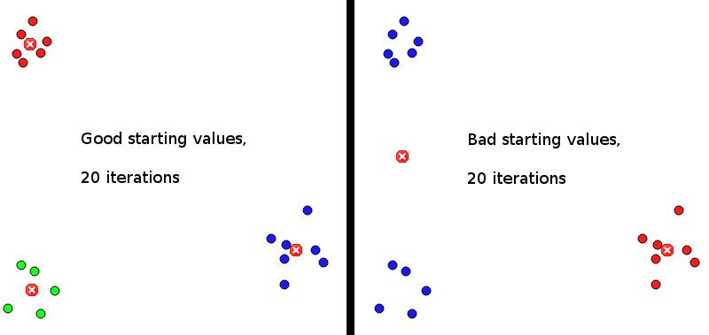
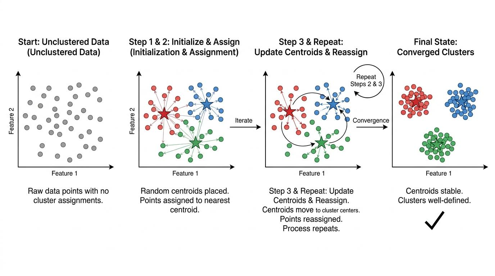

[Chat-GPT Link](https://chatgpt.com/s/t_6af08fc868288191b95dffc4a991c0a7)


# K-Means++ — Improved Centroid Initialization

## 1. What is K-Means++?

K-Means++ is an improved initialization technique for K-Means clustering.

Its purpose is to select better initial centroids so that they are more likely to be spread across the dataset.

### Why do we need it?

In standard K-Means, initial centroids are selected randomly. Sometimes, multiple centroids may be placed close to each other, resulting in poor initial clustering.

For example:




K-Means++ reduces this risk by using a distance-based probability strategy.

Important: It improves the chances of selecting good initial centroids; it does not guarantee the globally optimal clustering.

## 2. How does K-Means++ work?

Suppose we want to create $K=3$ clusters.

### Step 1: Select the first centroid randomly

Choose one data point uniformly at random from the dataset.

Every data point has an equal probability of being selected.

### Step 2: Calculate distance from the nearest selected centroid

For every data point, calculate its distance from the nearest already-selected centroid.

We represent it as:

 $D(x_i)=\min\_{c\in C}d(x_i,c)$

Where:

- $x_i$ = a data point.
- $C$ = set of already-selected centroids.
- $d(x_i,c)$ = distance between the data point and a centroid.
- $D(x_i)$ = distance from the nearest selected centroid.

### Step 3: Calculate the selection probability

K-Means++ selects the next centroid using a probability proportional to the square of the distance.

 $$\boxed{ P(x_i)= \frac{D(x_i)^2} {\sum\_{j=1}^{n}D(x_j)^2} }$$

This means:

- Points farther from existing centroids have a higher probability of selection.
- Points closer to existing centroids have a lower probability of selection.

Important: K-Means++ does not always select the farthest point. It uses weighted random selection.

### Step 4: Repeat the process

Repeat Steps 2 and 3 until all $K$ initial centroids have been selected.

### Step 5: Run standard K-Means

Once the initial centroids are selected, the normal K-Means algorithm starts:

1. Assign each data point to its nearest centroid.
2. Recalculate each centroid using the mean of its assigned data points.
3. Repeat assignment and centroid update until convergence.




Remember: K-Means++ only changes the centroid initialization process. The assignment and update steps remain the same as standard K-Means.

## 3. Numerical Example

Suppose we have already selected two centroids.

The distances of four candidate points from their nearest selected centroid are:

| Data point | Distance $D(x_i)$ | Squared distance |
| ---------- | --------------------- | ---------------- |
| A          | 1                     | 1                |
| B          | 2                     | 4                |
| C          | 3                     | 9                |
| D          | 4                     | 16               |
| Total      |                       | 30               |

Now calculate the probability of selecting each point:

$$P(x_i)=\frac{D(x_i)^2}{30}$$

| Data point | Probability    |
| ---------- | -------------- |
| A          | 1/30 = 3.33%   |
| B          | 4/30 = 13.33%  |
| C          | 9/30 = 30%     |
| D          | 16/30 = 53.33% |

**Selection probability**

**Point A**

3.33%

**Point B**

13.33%

**Point C**

30.00%

**Point D**

53.33%

Point D has the highest probability, but it is not guaranteed to be selected.

What do we learn?

Point D is farther away from existing centroids, so it has a higher probability of becoming the next centroid.

This encourages the initial centroids to be distributed across the dataset.

## 4. Why do we use squared distance?

There are two important reasons:

**1. Higher weight for distant points:** Squaring increases the relative importance of points that are far away.  

**2. Connection with the K-Means objective:** K-Means minimizes the sum of squared distances between data points and their assigned centroids (WCSS).

Remember the WCSS formula:

$$**WCSS=\sum\_{k=1}^{K}\sum\_{x_i\in C_k} \\|x_i-\mu_k\\|^2**$$

K-Means++ uses the same squared-distance idea during initialization.

## 5. Standard K-Means vs K-Means++

| Standard K-Means                                  | K-Means++                                                            |
| ------------------------------------------------- | -------------------------------------------------------------------- |
| Selects initial centroids randomly.               | Selects the first centroid randomly.                                 |
| Remaining centroids are also selected randomly.   | Remaining centroids are selected using distance-based probabilities. |
| Can produce poorly distributed initial centroids. | Encourages well-distributed initial centroids.                       |
| More sensitive to poor initialization.            | Reduces the risk of poor initialization.                             |

**One limitation:** K-Means++ is not an outlier-robust technique. Since it uses squared distances, an extreme outlier can receive a very high selection probability.

## 6. Does K-Means++ guarantee better clustering?

No. It improves initialization, but it does not guarantee the globally optimal solution.

There is, however, an important theoretical result from the original K-Means++ research.

Its initial seeding has an expected approximation guarantee:

$$\mathbb{E}[\phi]\leq 8(\ln K+2)\phi\_{OPT}$$

Where:

- $\phi$ = clustering cost after initialization.
- $\phi\_{OPT}$ = optimal K-Means clustering cost.
- $K$ = number of clusters.

This is an expected $O(\log K)$ approximation guarantee for the seeding cost, not a guarantee of finding the global optimum.

## 7. Time Complexity

Let:

- $n$ = number of data points.
- $K$ = number of clusters.
- $d$ = number of features.

| Operation                      | Time complexity |
| ------------------------------ | --------------- |
| One standard K-Means iteration | $O(nKd)$        |
| K-Means++ initialization       | $O(nKd)$        |

K-Means++ initialization requires additional computation compared with simply selecting random points.

However, better initialization can often reduce the number of iterations needed. This is not guaranteed for every dataset.

## 8. Python Implementation using Scikit-learn

```
from sklearn.cluster import KMeans
model = KMeans(    n_clusters=3,    init="k-means++",    n_init=10,    random_state=42)
labels = model.fit_predict(X)print("Cluster Labels:")print(labels)print("Centroids:")print(model.cluster_centers_)print("WCSS:")print(model.inertia_)
```

Understanding the parameters:

- `n_clusters=3`: Create three clusters.
- `init="k-means++"`: Use K-Means++ for centroid initialization.
- `n_init=10`: Run the algorithm 10 times with different initializations and keep the result with the lowest inertia.
- `random_state=42`: Make the random initialization reproducible.

Note: Recent Scikit-learn versions use `n_init="auto"` as the default. With K-Means++, this generally means one run. Here, we explicitly set it to 10.

Scikit-learn also uses a greedy variant of K-Means++ by default, which can make multiple candidate selections at each step.

## 9. Interview-Friendly Definition

K-Means++ is an improved initialization technique for K-Means clustering. It selects the first centroid randomly and selects subsequent centroids using a probability proportional to the squared distance from the nearest already-selected centroid. This encourages well-distributed initial centroids and reduces the risk of poor initialization.

## 10. Quick Revision

Remember these five points:

1. First centroid → Uniform random selection.
2. Calculate distance → Nearest selected centroid.
3. Calculate probability → Squared distance.
4. Repeat → Until K centroids are selected.
5. Run K-Means → Assignment and centroid updates.

The most important formula:

\\[ P(x_i)= \frac{D(x_i)^2} {\sum\_{j=1}^{n}D(x_j)^2} \\]

Ultimate intuition: K-Means++ tries to avoid selecting all initial centroids from the same small region. It gives distant points a higher chance of becoming centroids, helping K-Means start with a better initial configuration.

