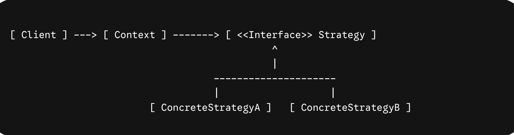
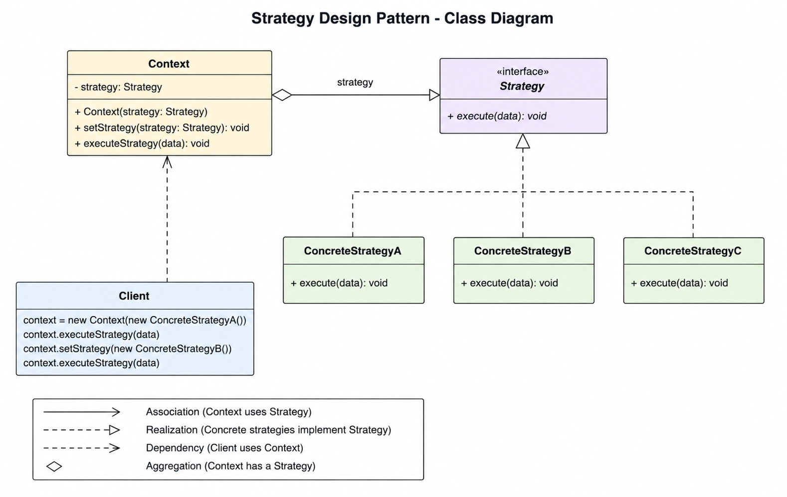

## STRATEGY PATTERN

The **`Strategy Design Pattern`** is a **`behavioral design pattern`** that allows you to define a **`family of algorithms`**, **`encapsulate each one in a separate class`**, and **`make them interchangeable`**. 

<details>
<summary><b>Explanation</b></summary>

Here is that exact textbook definition broken down piece by piece into plain English, using a simple iOS example (sorting a list of products):

### 1. "...is a behavioral design pattern..."

* **What it means:** Design patterns fall into three buckets: how objects are *created* (Creational), how they are *assembled* (Structural), and how they *act and talk to each other* (Behavioral).
* **In plain English:** This pattern is purely about **how an object does its job** and delegates work to other objects.

### 2. "...that allows you to define a family of algorithms..."

* **What it means:** "Algorithm" just means a way of doing a specific task, and "family" means you have several different ways to accomplish that same goal.
* **In plain English:** You have multiple ways to solve the exact same problem. For example, in a shopping app, your goal is **Sorting Products**, and your "family" of ways to do it is:
* Sort by Price (Low to High)
* Sort by Rating
* Sort by Newest Arrivals


### 3. "...encapsulate each one in a separate class..."

* **What it means:** "Encapsulate" means wrapping code up inside its own self-contained box (a `class` or `struct` in Swift) so it doesn't leak or tangle with anything else.
* **In plain English:** Instead of putting all three sorting rules inside one messy `if-else` block inside your `ProductViewModel`, you put each rule in its own neat, separate file/struct (`PriceSort`, `RatingSort`, `NewestSort`).

### 4. "...and make them interchangeable."

* **What it means:** Because all those separate classes follow the exact same rules (a Swift `protocol`), the main object using them can swap one out for another on the fly without breaking.
* **In plain English:** Think of a **gaming console and game cartridges**. The console (`ProductViewModel`) doesn't care which cartridge (`SortStrategy`) you plug in—as long as it fits the slot, you can eject one and snap in another at any time while the app is running.

---

### Quick 1-Sentence Translation

> *"Instead of hardcoding multiple ways of doing a task inside one class, you put each method in its own plug-and-play box behind a shared protocol so you can swap them out whenever you want."*
</details>  
 
* Encapsulates different algorithms into separate strategy classes, allowing dynamic selection or switching at runtime.  
  
* Promotes flexibility by reducing complex conditional logic and making code easier to maintain.

We usually **`combine Strategy with Factory`** — Factory decides which strategy to create based on runtime input, and the context uses it without knowing the implementation.

Examples include **`Google Maps navigation modes`** and **`payment methods`**.  

#### Simple & Perfect Definition (Use this in interview)

> **Strategy Pattern is used when the same task can be done in multiple ways, and we want to choose the way at runtime without changing existing code.**

---  

## The Core Components
The Strategy pattern relies on three main elements:  

    

1. **Strategy (Interface/Protocol):** This is common to all supported algorithms. It declares a method that the context uses to execute a strategy.  

2. **Concrete Strategies:** These are the actual classes that implement the different variations of the algorithm.  

3. **Context:** This is the class that maintains a reference to one of the strategy objects. It doesn't know how the strategy is implemented; it just calls the method exposed by the strategy interface.  

4. **Client:** Responsible for selecting and configuring the appropriate strategy for the context.  

    * Decides which strategy to use based on the problem.  
    * Passes the chosen strategy to the context for execution.  
    
---
    
    
## Class Diagram

[**Explanation**](https://github.com/siddharth201/MyNotes/blob/main/miscellaneous/StrategyDesignPattern_Class_Diagram.md)  

---

## 🗺️ EXAMPLE 1: GOOGLE MAPS NAVIGATION (RUNNABLE)

## 🎯 Problem

Google Maps lets you choose:

* 🚗 Driving
* 🚶 Walking
* 🚲 Cycling

Destination is same → route calculation changes.

This is **Strategy Pattern**.

---

## 1️⃣ Strategy Protocol

```swift
protocol RouteStrategy {
    func buildRoute(from source: String, to destination: String) -> String
}
```

---

## 2️⃣ Concrete Strategies

```swift
class DrivingRouteStrategy: RouteStrategy {
    func buildRoute(from source: String, to destination: String) -> String {
        return "Driving route from \(source) to \(destination) (30 mins)"
    }
}

class WalkingRouteStrategy: RouteStrategy {
    func buildRoute(from source: String, to destination: String) -> String {
        return "Walking route from \(source) to \(destination) (2 hours)"
    }
}

class CyclingRouteStrategy: RouteStrategy {
    func buildRoute(from source: String, to destination: String) -> String {
        return "Cycling route from \(source) to \(destination) (1 hour)"
    }
}
```

---

## 3️⃣ Factory to Get Strategy at Runtime ✅

```swift
enum TravelMode {
    case driving, walking, cycling
}

class RouteStrategyFactory {
    static func makeStrategy(for mode: TravelMode) -> RouteStrategy {
        switch mode {
        case .driving:
            return DrivingRouteStrategy()
        case .walking:
            return WalkingRouteStrategy()
        case .cycling:
            return CyclingRouteStrategy()
        }
    }
}
```

---

## 4️⃣ Context (Google Maps Engine)

```swift
class GoogleMapsNavigator {
    private let strategy: RouteStrategy
    
    init(strategy: RouteStrategy) {
        self.strategy = strategy
    }
    
    func showRoute(from source: String, to destination: String) {
        let route = strategy.buildRoute(from: source, to: destination)
        print(route)
    }
}
```

---

## 5️⃣ RUN THIS (Playground)

```swift
let mode: TravelMode = .cycling

let strategy = RouteStrategyFactory.makeStrategy(for: mode)
let navigator = GoogleMapsNavigator(strategy: strategy)

navigator.showRoute(from: "Home", to: "Office")
```

### ✅ Output

```
Cycling route from Home to Office (1 hour)
```

👉 Change `.cycling` to `.driving` or `.walking`
👉 NO change in `GoogleMapsNavigator`
👉 **Strategy changed at runtime**

---

## 💳 EXAMPLE 2: PAYMENT SYSTEM (RUNNABLE)

## 🎯 Problem

User can pay via:

* Card
* UPI
* Wallet

Instead of `if–else`, use **Strategy**.

---

## 1️⃣ Strategy Protocol

```swift
protocol PaymentStrategy {
    func pay(amount: Double)
}
```

---

## 2️⃣ Concrete Strategies

```swift
class CardPaymentStrategy: PaymentStrategy {
    func pay(amount: Double) {
        print("Paid ₹\(amount) using Card")
    }
}

class UPIPaymentStrategy: PaymentStrategy {
    func pay(amount: Double) {
        print("Paid ₹\(amount) using UPI")
    }
}

class WalletPaymentStrategy: PaymentStrategy {
    func pay(amount: Double) {
        print("Paid ₹\(amount) using Wallet")
    }
}
```

---

## 3️⃣ Factory to Select Strategy at Runtime ✅

```swift
enum PaymentMethod {
    case card, upi, wallet
}

class PaymentStrategyFactory {
    static func makeStrategy(for method: PaymentMethod) -> PaymentStrategy {
        switch method {
        case .card:
            return CardPaymentStrategy()
        case .upi:
            return UPIPaymentStrategy()
        case .wallet:
            return WalletPaymentStrategy()
        }
    }
}
```

---

## 4️⃣ Context (Checkout)

```swift
class Checkout {
    private let strategy: PaymentStrategy
    
    init(strategy: PaymentStrategy) {
        self.strategy = strategy
    }
    
    func pay(amount: Double) {
        strategy.pay(amount: amount)
    }
}
```

---

## 5️⃣ RUN THIS (Playground)

```swift
let method: PaymentMethod = .upi

let strategy = PaymentStrategyFactory.makeStrategy(for: method)
let checkout = Checkout(strategy: strategy)

checkout.pay(amount: 999)
```

### ✅ Output

```
Paid ₹999.0 using UPI
```

👉 Change `.upi` to `.card` or `.wallet`
👉 Checkout code never changes
👉 Strategy swaps dynamically

---

## 🧠 WHY STRATEGY + FACTORY IS PERFECT

| Pattern      | Responsibility                        |
| ------------ | ------------------------------------- |
| **Strategy** | Encapsulates algorithms               |
| **Factory**  | Decides which strategy to create      |
| **Context**  | Uses strategy without knowing details |

This combo:

* Removes `if–else`
* Follows Open/Closed Principle
* Is very testable
* Is industry standard

---

## ⭐ MEMORY TRICK

> **Strategy = HOW to do something
> Factory = WHICH strategy to use**

---

## Q. If we have to achieve the same thing but we have many ways to do it, then we will use Strategy pattern?. 
[Answer](https://github.com/siddharth201/MyNotes/blob/main/miscellaneous/StrategyDesignPattern_Followup1.md) 

## Q. WHEN and WHERE to introduce Factory in Strategy (step number)?
[Answer](https://github.com/siddharth201/MyNotes/blob/main/miscellaneous/StrategyDesignPattern_Followup2.md)


